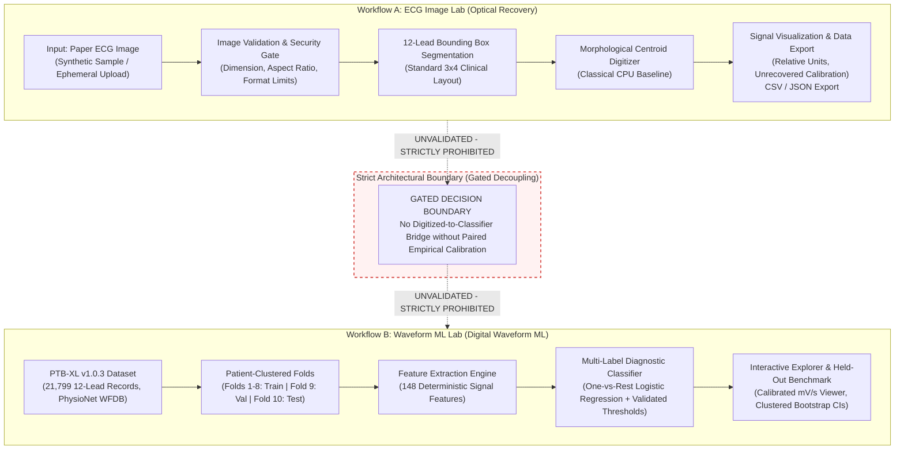

# ECG Insight Lab (CardioSense) — Research Platform

**ECG Image Digitization and Signal Analysis Platform**  
*An academic research prototype for paper ECG image digitization, validation, and reproducible cardiac waveform benchmarking.*

[](https://www.python.org/)
[](https://opensource.org/licenses/MIT)
[](tests/)
[](app.py)

---

## 1. Project Motivation & Scope

Electrocardiograms (ECGs) remain the clinical cornerstone of cardiac electrophysiology. While historical ECGs frequently reside on paper or scanned image formats, modern predictive algorithms operate on continuous multi-channel digitized voltages. Bridging these paradigms requires rigorous engineering, honest uncertainty quantification, and strict scientific boundaries.

**ECG Insight Lab** is an open-source, software-only research platform developed to:
1. Systematically investigate the algorithmic feasibility and error profiles of recovering 1D physiological time-series from standard 12-lead paper ECG images.
2. Establish a reproducible, transparent, leak-free benchmark for multi-label cardiac diagnostic classification on digitized waveforms from PhysioNet's public **PTB-XL v1.0.3** dataset.
3. Provide a publication-grade, privacy-first editorial user interface for interactive inspection, diagnostics, and pedagogical demonstration.

### Non-Clinical Research Disclaimer
> [!IMPORTANT]
> **Research Prototype Only — Not for Clinical Use:**  
> This software is designed strictly for academic exploration and scientific methodology benchmarking. It is **not** a certified medical device (FDA 510(k), CE mark, or equivalent) and must **never** be used for clinical diagnosis, patient triage, risk stratification, or healthcare treatment decisions. No physical patient sensors or embedded hardware (such as ESP32 or AD8232) are connected or required.

---

## 2. Core Architectural Principles & System Design



### Key Architectural Tenets
1. **Strictly Decoupled Workflows:**
   - **Workflow A (ECG Image Lab):** Ingestion, format/resolution validation, 12-lead segmentation, and 1D continuous waveform extraction with CSV/JSON export. Calibration status is honestly designated as `UNRECOVERED` with `RELATIVE` units unless physical grid spacing is verified.
   - **Workflow B (Waveform ML Lab):** Digital waveform feature extraction and diagnostic classification across 5 SCP-ECG superclasses (`NORM`, `MI`, `STTC`, `CD`, `HYP`) trained and evaluated on official patient-stratified partitions.
2. **Gated Integration Boundary:** The optical digitizer output is **not** connected to the diagnostic ML model. Unvalidated synthetic paper waveforms cannot be fed into the waveform classifier without causing uncontrolled domain shift.
3. **Cryptographic Model Trust:** Model serialization uses SHA-256 sidecar manifests (`waveform_lr_model.joblib.manifest.json`). Untrusted legacy pickles and unmanifested binaries are strictly quarantined and rejected by code policy.
4. **Zero-Persistence Privacy:** Uploaded images and signals are processed entirely in volatile RAM buffers. No files, logs, or patient identifiers are ever written to disk or transmitted across networks.
5. **Quiet Academic Editorial Interface:** A distraction-free visual environment designed according to research editorial standards (warm ivory `#F7F6F2`, deep charcoal `#252722`, and forest green `#455D4A`).

---

## 3. Workflow Features & Capabilities

### Workflow A: ECG Image Lab
- **Multi-Format Ingestion:** Accepts PNG, JPEG, TIFF, and WebP images with robust security checks (maximum file size 15 MB, pixel dimensions up to $6000 \times 6000$, decompression bomb mitigation).
- **Automated Lead Segmentation:** Automatically partitions standard clinical $3 \times 4$ layouts into 12 distinct leads (I, II, III, aVR, aVL, aVF, V1–V6).
- **Classical Morphological Digitizer:** Natively runs on CPU using intensity-weighted centroid tracking and adaptive thresholding to extract continuous 1D waveforms.
- **Honest Metadata:** Displays lead dimensions, detection rate, sample counts, relative amplitude bounds, and explicit calibration warnings.
- **Structured Data Export:** One-click export of extracted time-series to CSV (`time_relative`, `lead_name`, `amplitude_relative`) and JSON metadata.

### Workflow B: Waveform ML Lab
- **Calibrated Multi-Channel Viewer:** Interactive visualization of full 10-second 12-lead signals with standard clinical grid coordinates (Time in seconds, Voltage in millivolts).
- **148 Deterministic Signal Features:** Time-domain statistics, QRS complex durations, RR-interval variability, and spectral band power across all 12 channels.
- **Multi-Label Inference:** Outputs calibrated probability scores and decision thresholds for 5 SCP-ECG diagnostic superclasses:
  - `NORM`: Normal ECG
  - `MI`: Myocardial Infarction
  - `STTC`: ST/T changes
  - `CD`: Conduction Disturbance
  - `HYP`: Hypertrophy
- **Held-Out Benchmark Transparency:** Displays full held-out test fold metrics evaluated across all 2,198 records with patient-clustered 95% bootstrap confidence intervals.

---

## 4. Benchmark Results & Model Comparison

### Held-Out Test Evaluation (PTB-XL Fold 10)
- **Evaluation Sample Size:** $N = 2,198$ records across $1,883$ distinct patients (strictly isolated from training Folds 1–8 and validation Fold 9).
- **Patient Leakage:** $0$ overlapping patients across partitions.

| Diagnostic Superclass | Test Prevalence | Precision | Recall | F1-Score | PR-AUC |
| :--- | :---: | :---: | :---: | :---: | :---: |
| **NORM** (Normal) | $43.4\%$ | $0.6974$ | $0.7872$ | **$0.7396$** | $0.7937$ |
| **MI** (Myocardial Infarction) | $25.1\%$ | $0.5519$ | $0.6273$ | **$0.5872$** | $0.5833$ |
| **STTC** (ST/T Changes) | $24.0\%$ | $0.5283$ | $0.6091$ | **$0.5658$** | $0.5401$ |
| **CD** (Conduction Disturbance) | $22.7\%$ | $0.5758$ | $0.6693$ | **$0.6190$** | $0.5977$ |
| **HYP** (Hypertrophy) | $12.1\%$ | $0.4633$ | $0.6405$ | **$0.5379$** | $0.4287$ |
| **Macro Average** | — | **$0.5633$** | **$0.6667$** | **$0.6090$** | **$0.5887$** |

### Paired Model Comparison & Statistical Methodology
In Phase 3.2.1, a paired patient-cluster bootstrap comparison ($B = 2,000$ replicates) was conducted on the exact same Fold 10 test cohort ($N=2,198$) between the Phase 3.1 Pilot Model and the Phase 3.2 Full-Fold Model:

- **Point Estimates:** Pilot Model Macro F1 = $0.4583$ vs. Full-Fold Model Macro F1 = $0.6090$ ($\Delta = +0.1510$).
- **95% Paired Patient-Clustered Bootstrap CI for Difference:** $[+0.1343, +0.1681]$.

> [!NOTE]
> **Essential Methodological Caveats:**
> 1. **Complete Pipeline Comparison:** The observed performance difference represents a comparison between two *complete pipelines*. It must not be attributed solely to training set size, because the pilot and full-fold pipelines also utilized different validation sample sizes for threshold tuning (30 records vs. 2,193 records).
> 2. **Empirical Bootstrap Observation:** Exactly `0 of 2,000` paired bootstrap replicates had a non-positive difference ($P \le 0$). This is an empirical observation from finite resampling, not mathematical proof that the probability is zero. The confidence interval describes test-cohort sampling uncertainty conditional on these fixed, fitted models, and does not capture variation across retraining runs.

---

## 5. Repository Structure

```text
code/
├── app.py                            # Streamlit research web application (Quiet Academic UI)
├── ecg_lab/                          # Core modular library
│   ├── __init__.py                   # Package exports
│   ├── config.py                     # Editorial design tokens, colors & upload limits
│   ├── diagnostics.py                # System self-test & health verification suite
│   ├── models.py                     # Typed dataclasses & validation result models
│   ├── validation.py                 # In-memory image safety & format validation
│   ├── digitization/                 # Subsystem for waveform digitization (Workflow A)
│   │   ├── __init__.py
│   │   ├── types.py                  # DigitizationResult, LeadSignal, Calibration Enums
│   │   ├── adapter.py                # ECGDigitizer protocol & Open-ECG adapter
│   │   ├── baseline.py               # Classical morphological centroid digitizer
│   │   └── service.py                # High-level dispatch & CSV/JSON export
│   └── waveform_ml/                  # Subsystem for digital waveform ML (Workflow B)
│       ├── __init__.py
│       ├── config.py                 # Constants, official checksums & fold splits
│       ├── dataset.py                # Metadata parsing, SCP mapping & split integrity
│       ├── features.py               # 148 deterministic signal features & caching
│       ├── models.py                 # One-vs-Rest Logistic Regression & manifest checks
│       ├── train.py                  # Training pipeline & validation threshold tuning
│       ├── evaluate.py               # Multi-label metrics & patient-clustered bootstrap
│       └── cli.py                    # Unified CLI command interface
├── tests/                            # Comprehensive automated test suite (64 tests)
│   ├── test_validation.py            # Image input validation & security limits
│   ├── test_digitization.py          # Classical digitizer & synthetic benchmark
│   ├── test_waveform_dataset.py      # Metadata loading & SCP-statement mapping
│   ├── test_waveform_splits.py       # Patient isolation & zero fold leakage
│   ├── test_waveform_features.py     # Deterministic feature extraction & invalidation
│   ├── test_waveform_metrics.py      # Multi-label evaluation & threshold selection
│   ├── test_waveform_isolation.py    # Cryptographic manifests & legacy quarantine
│   └── test_productization.py        # Diagnostics, in-memory privacy, safe fixtures
├── sample_data/                      # Small, licensed test assets & synthetic fixtures
│   ├── synthetic_12lead.png          # Synthetic 12-lead benchmark (NOT PATIENT DATA)
│   └── synthetic_12lead_gt.csv       # Synthetic 12-lead ground truth
├── legacy/                           # Quarantined historical artifacts (March 2025)
├── docs/                             # Technical reports, audits & release specifications
│   ├── AUDIT_REPORT.md               # Phase 0 technical and architecture audit
│   ├── PHASE2_FEASIBILITY.md         # Upstream digitizer feasibility evaluation
│   ├── PHASE2_REPORT.md              # Phase 2 optical digitization report
│   ├── PHASE3_REPORT.md              # Phase 3 digital waveform ML report
│   ├── PHASE3_1_EVALUATION_AUDIT.md  # Phase 3.1 Fold 10 benchmark audit
│   ├── PHASE3_2_FULL_FOLD_TRAINING_REPORT.md # Full-fold training report
│   ├── PHASE3_2_1_PAIRED_COMPARISON_AUDIT.md # Paired bootstrap comparison audit
│   ├── PHASE4_DEPLOYMENT_ASSESSMENT.md       # Feasibility, privacy & memory assessment
│   ├── PHASE4_REPORT.md              # Phase 4 productization & acceptance report
│   ├── MODEL_CARD.md                 # Formal research-use model card
│   ├── DATA_SOURCES_AND_LICENSES.md  # Dataset citations, SCP taxonomy & software licenses
│   └── UI_CAPTURE_GUIDE.md           # Visual walkthrough & UI capture guide
├── requirements.txt                  # Pinned, reproducible Python dependencies
└── README.md                         # This documentation
```

---

## 6. Installation & Reproducible Execution

### Prerequisites
- Operating System: Linux, macOS, or Windows
- Python: **3.10, 3.12, or 3.14** (tested and verified on Python 3.14.4)
- Memory: $\ge 1.0\,\text{GiB}$ RAM available

### Step 1: Environment Setup
```bash
# Clone the repository and navigate to the code directory
git clone <repo-url>
cd code

# Create and activate a clean virtual environment
python3 -m venv .venv
source .venv/bin/activate  # On Windows: .venv\Scripts\activate

# Install pinned dependencies
pip install --upgrade pip
pip install -r requirements.txt
```

### Step 2: Run Automated Quality Gates
Execute the complete test suite:
```bash
pytest -v
```
*Expected Result: 64 passed tests in ~4.5 seconds (100% pass rate, zero errors, zero warnings).*

### Step 3: Run System Diagnostics via CLI
Verify system environment, dataset status, and cryptographic model integrity:
```bash
python -m ecg_lab.waveform_ml.cli diagnostics
```
*Expected Output: All 7 health checks report `[PASS]` and system reports `OPERATIONAL`.*

### Step 4: Launch the Streamlit Web Application
```bash
streamlit run app.py
```
*Open your web browser and navigate to `http://localhost:8501`.*

---

## 7. Command Line Interface (CLI) Guide

The unified CLI provides reproducible commands for the entire data and ML pipeline:

```bash
# 1. Run system diagnostics and health audit
python -m ecg_lab.waveform_ml.cli diagnostics

# 2. Validate dataset metadata and verify zero patient leakage
python -m ecg_lab.waveform_ml.cli validate --verify-checksums

# 3. Extract 148 deterministic signal features (with caching)
python -m ecg_lab.waveform_ml.cli extract-features

# 4. Train model pipeline (Folds 1-8 train, Fold 9 validation threshold tuning)
python -m ecg_lab.waveform_ml.cli train

# 5. Evaluate frozen model on held-out test fold (Fold 10)
python -m ecg_lab.waveform_ml.cli evaluate
```

---

## 8. Data Privacy & Safe Demo Protocol

### Zero-Persistence Privacy Guarantee
- **In-Memory Only:** When an image is uploaded in the ECG Image Lab, it is validated and processed entirely within Python memory buffers (`BytesIO`).
- **No Disk Retention:** Uploaded images and extracted waveforms are never written to disk, cached to persistent storage, or sent to external logging services.
- **De-identification:** No protected health information (PHI) or personal data is collected or handled.

### Safe Demo Mode
- **No Hardware Needed:** The application runs out of the box using built-in synthetic fixtures (`sample_data/synthetic_12lead.png`).
- **Clear Synthetic Labeling:** All synthetic signals are prominently marked `SYNTHETIC DEMO — NOT PATIENT DATA`.
- **No Fabricated Predictions:** Model predictions are disabled for synthetic inputs unless explicitly authorized by experimental code policy.

---

## 9. Citations, Licensing & Academic Provenance

### Open-Source License
The application codebase and documentation are licensed under the [MIT License](LICENSE).

### Data & Literature Citations
- **PTB-XL ECG Dataset:**  
  Wagner, P., Strodthoff, N., Bousseljot, R. D., Kreiseler, D., Lunze, F. I., Samek, W., & Schaeffter, T. (2020). *PTB-XL, a large publicly available electrocardiography dataset*. Scientific Data, 7(1), 154. [https://doi.org/10.1038/s41597-020-0495-6](https://doi.org/10.1038/s41597-020-0495-6). Distributed under [CC BY 4.0](https://creativecommons.org/licenses/by/4.0/).
- **PhysioNet Repository:**  
  Goldberger, A., et al. (2000). *PhysioBank, PhysioToolkit, and PhysioNet: Components of a new research resource for complex physiologic signals*. Circulation, 101(23), e215–e220. [https://doi.org/10.1161/01.CIR.101.23.e215](https://doi.org/10.1161/01.CIR.101.23.e215).
- **Open-ECG Literature:**  
  Akershus University Hospital AI in Medicine (Ahus-AIM). *Electrocardiogram-Digitization*. Evaluated under [CC BY-SA 4.0](https://creativecommons.org/licenses/by-sa/4.0/).

For detailed dependency licenses and compliance guidelines, see [docs/DATA_SOURCES_AND_LICENSES.md](docs/DATA_SOURCES_AND_LICENSES.md).
