# CardioSense — ECG Insight Lab: Reproducible Machine Learning and Signal Analysis for ECG Data

**Academic Research & Graduate Portfolio Prototype for Physiological Signal Processing and Machine Learning**  
*A transparent, leak-free framework bridging historical electrocardiographic signals, decoupled predictive models, and reproducible biomedical engineering.*

[](https://github.com/omkar703/ECG_Insight_Lab_CardioSense/actions/workflows/ci.yml)
[](https://www.python.org/)
[](https://opensource.org/licenses/MIT)
[](tests/)
[](app.py)
[](artifacts/waveform_ml/waveform_lr_model.joblib.manifest.json)

---

## 1. Project Overview & Research Scope

**ECG Insight Lab (CardioSense)** is an open-source, software-only research platform developed to investigate reproducible signal conditioning, deterministic feature engineering, and decoupled machine learning models across public electrocardiogram benchmarks.

### Active Core Workflows

The platform is architected around three active, mathematically decoupled workflows:
1. **Workflow 1: 12-Lead ECG Multi-Label Classification (PTB-XL v1.0.3)**  
   Multi-label diagnostic classification across 5 SCP-ECG superclasses (`NORM`, `MI`, `STTC`, `CD`, `HYP`) using 148 deterministic waveform features and validation-calibrated decision thresholds on official patient-stratified folds.
2. **Workflow 2: Single-Lead Beat Analysis (MIT-BIH Arrhythmia Database v1.0.0)**  
   Autonomous Pan-Tompkins QRS peak detection, morphological windowing, and 4-class beat classification (`N`, `S`, `V`, `Q`) evaluated across 21 held-out patient records under strict patient-disjoint partitioning.
3. **Workflow 3: AD8232 Hardware Prototype — Offline Simulation & Acquisition**  
   Self-contained benchtop analog front-end prototyping (AD8232 + Arduino Uno) with line-oriented UART streaming, offline stream simulation, causal digital filtering, and safety guardrails strictly enforcing electrical safety standards (IEC 60601-1).

### Archived Research Module: Optical Paper Digitizer
> [!NOTE]
> **Archival Status:** The Optical Paper Digitizer module has been relocated from the primary navigation and default user experience into an isolated, collapsible archival section. While the classical morphological trace extractor achieves $r = 0.6932$ on synthetic benchmarks, synthetic evaluations do not establish generalization to complex, wrinkled, or low-contrast clinical paper ECGs. The implementation, tests, and synthetic fixtures remain preserved for transparency and ongoing investigation.
---

## 2. Research Documentation Suite

For comprehensive evaluation by professors, admissions committees, and technical reviewers, see the dedicated research documentation:

- **[Portfolio Report (docs/PORTFOLIO_REPORT.md)](docs/PORTFOLIO_REPORT.md)** — Executive overview, quantitative achievements, and engineering contributions.
- **[System Architecture (docs/ARCHITECTURE.md)](docs/ARCHITECTURE.md)** — Decoupled pipeline topology, data contracts, and safety guardrails.
- **[Research Methods (docs/RESEARCH_METHODS.md)](docs/RESEARCH_METHODS.md)** — Signal conditioning, feature engineering mathematics, leak-free partitioning, and bootstrap protocols.
- **[Results & Limitations (docs/RESULTS_AND_LIMITATIONS.md)](docs/RESULTS_AND_LIMITATIONS.md)** — Full quantitative benchmarks, confusion matrices, failure modes, and honest caveats.
- **[Single-Lead Imbalance Experiment (docs/reports/single_lead_imbalance_experiment.md)](docs/reports/single_lead_imbalance_experiment.md)** — Controlled study on class imbalance and cost-sensitive minority boosting.
- **[Changelog (CHANGELOG.md)](CHANGELOG.md)** — Complete chronological audit trail of architectural milestones.

---

## 3. Visual Figures & Demonstration Assets

All figures embedded below are genuinely produced from actual project data and reproducible code:

### Calibrated 12-Lead Digital ECG Waveform from PTB-XL (Workflow 1)

*Figure 1: Authentic 10-second 12-lead digital ECG recording (`00001_lr`) from PTB-XL v1.0.3 sampled at 100 Hz, with physical axes calibrated in seconds and millivolts.*

---

### Held-Out Benchmark Performance & Paired Comparison (PTB-XL Fold 10, $N=2,198$)
| Model Performance on Fold 10 | Paired Patient-Cluster Bootstrap Distribution |
| :---: | :---: |
|  |  |
| *Figure 2: Full-fold model F1 & PR-AUC vs. pilot model across 5 diagnostic superclasses.* | *Figure 3: Paired difference in Macro F1 ($\Delta = +0.1510$, $95\%$ CI $[0.1343, 0.1681]$, $B=2,000$).* |

---

### Hardware Prototype Benchtop Setup & Real-Time Serial Stream Evidence (Workflow 3)

Benchtop verification of the AD8232 analog front-end and real-time UART serial data transmission:

| AD8232 to Arduino Uno Setup | Live ADC Waveform in Serial Plotter | AD8232 & Microcontroller Wiring Schematic |
| :---: | :---: | :---: |
|  |  |  |
| *Figure 4: Physical benchtop prototype — AD8232 single-lead ECG front-end wired to Arduino Uno with active power & lead indicators.* | *Figure 5: Real-time serial acquisition on COM9 (9600 baud) displaying analog P-QRS-T complexes.* | *Figure 6: Microcontroller interface wiring schematic (3.3V, GND, Output ADC, and LO+/LO- leads-off detection).* |

---

### Interactive Application Video Demonstrations

The complete interactive research interface can be observed in real time across the two core platform modes:

#### 1. Practical Lab & Live Experiment Walkthrough (`lab.mp4`)
*Demonstrates interactive 12-lead signal exploration, zero-phase filtering and Bode response, diagnostic superclass inference, confusion matrices, single-lead MIT-BIH Holter beat classification, and LLM clinical explanations.*

[](https://github.com/omkar703/ECG_Insight_Lab_CardioSense/blob/main/docs/assets/lab.mp4)

> [!TIP]
> **[Click here to watch the full 1080p video in GitHub native video player (`docs/assets/lab.mp4`)](https://github.com/omkar703/ECG_Insight_Lab_CardioSense/blob/main/docs/assets/lab.mp4)**.

---

#### 2. Guided Educational Demo Walkthrough (`demo_guide.mp4`)
*Demonstrates the 9-step pedagogical walkthrough covering cardiac electrophysiology, data leakage prevention, signal conditioning, decoupled machine learning architectures, and calibrated diagnostic decision cutoffs.*

[](https://github.com/omkar703/ECG_Insight_Lab_CardioSense/blob/main/docs/assets/demo_guide.mp4)

> [!TIP]
> **[Click here to watch the full 1080p video in GitHub native video player (`docs/assets/demo_guide.mp4`)](https://github.com/omkar703/ECG_Insight_Lab_CardioSense/blob/main/docs/assets/demo_guide.mp4)**.

---

## 4. Core Architectural Principles & System Design

```mermaid
flowchart TD
    subgraph WF_1["Workflow 1: 12-Lead ECG Classification (PTB-XL)"]
        B1["PTB-XL v1.0.3 Dataset
(21,799 12-Lead Records, PhysioNet WFDB)"] --> B2["Patient-Clustered Folds
(Folds 1-8: Train | Fold 9: Val | Fold 10: Test)"]
        B2 --> B3["Feature Extraction Engine
(148 Deterministic Signal Features)"]
        B3 --> B4["Multi-Label Diagnostic Classifier
(One-vs-Rest Logistic Regression + Validated Cutoffs)"]
        B4 --> B5["Interactive Explorer & Held-Out Benchmark
(Calibrated mV/s Viewer, Clustered Bootstrap CIs)"]
    end

    subgraph DECOUPLING["Strict Architectural Boundaries (Decoupling)"]
        style DECOUPLING fill:#fff2f2,stroke:#d9534f,stroke-width:2px,stroke-dasharray: 5 5
        BOUNDARY["GATED DECISION BOUNDARY
No Paper-to-Digital Classification Bridge
No Single-Lead Heart Attack / MI Diagnosis
No Live Hardware Sensor Claims"]
    end

    subgraph WF_2["Workflow 2: Single-Lead Beat Analysis (MIT-BIH)"]
        C1["MIT-BIH Arrhythmia Database v1.0.0
(48 Records, 47 Patients, 360 Hz)"] --> C2["Patient-Disjoint Splits
(16 Train | 7 Val | 21 Held-Out Test)
Records 201 & 202 strictly co-located"]
        C2 --> C3["Autonomous Signal-Based R-Peak Detector
(Pan-Tompkins Filter — Zero Annotations at Inference)"]
        C3 --> C4["Feature Extraction & Classifier
(47 Descriptors + Balanced Random Forest)"]
        C4 --> C5["Recorded Playback Simulation in Streamlit
(RECORDED DATA REPLAY — NOT LIVE HARDWARE)"]
    end

    subgraph WF_3["Workflow 3: AD8232 Hardware Prototype & Simulation"]
        H1["AD8232 Analog Front-End
(3-Lead Differential Instrumentation Amp)"] --> H2["Arduino Uno ADC Streaming
(115,200 Baud UART, 360 Hz Scheduled Sampling)"]
        H2 --> H3["Offline Transport Simulator & Parser
(Frame Validation, Packet Verification)"]
        H3 --> H4["Causal Digital Conditioning
(0.5-40 Hz Bandpass, 50 Hz Notch)"]
        H4 --> H5["Streamlit Prototype UI
(Persistent Simulation Notice & IEC 60601-1 Guardrails)"]
    end

    subgraph ARCHIVED["Archived Research Module: Optical Paper Digitizer"]
        style ARCHIVED fill:#f9f9f9,stroke:#999999,stroke-width:1px,stroke-dasharray: 3 3
        A1["Input: Paper ECG Image
(Synthetic Sample Fixture)"] --> A2["Image Validation Gate
(Dimension, Aspect Ratio, Decompression Guards)"]
        A2 --> A3["12-Lead Bounding Box Segmentation
(Standard 3x4 Clinical Layout)"]
        A3 --> A4["Morphological Centroid Digitizer
(Classical CPU Baseline)"]
        A4 --> A5["Signal Visualization & Data Export
(Relative Units, Unrecovered Calibration)"]
    end

    ARCHIVED -.->|UNVALIDATED ON REAL SCANS - GATED| BOUNDARY
    BOUNDARY -.->|PROHIBITED| WF_1
    BOUNDARY -.->|PROHIBITED| WF_2
    WF_3 -.->|SIMULATION ONLY - UNCALIBRATED ADC GATED| BOUNDARY
```



### Architectural Tenets
1. **Strict Subsystem Decoupling:**
   - **Workflow 1 (12-Lead Waveform ML):** Digital waveform feature extraction and diagnostic classification across 5 SCP-ECG superclasses (`NORM`, `MI`, `STTC`, `CD`, `HYP`) trained and evaluated on official patient-stratified partitions.
   - **Workflow 2 (Single-Lead Beat Analysis):** Single-channel beat-type classification using a project-defined 4-class beat grouping (`N`, `S`, `V`, `Q`, with ventricular fusion beats `F` merged into `Q`) on MIT-BIH Holter data, autonomous Pan-Tompkins QRS detection, and simulated recorded playback.
   - **Workflow 3 (Hardware Prototype & Offline Simulation):** Self-contained firmware, schematics, host protocol, offline simulator, and dedicated Streamlit simulation UI (`Hardware Prototype — Offline AD8232 Simulation`) under [`hardware/`](hardware/README.md). Operates completely offline with simulated 10-bit ADC transport, protocol serialization/parsing, simulator inverse conversion, visible per-beat predictions, and post-hoc reference evaluation. Raw ADC counts are never fed into ML classifiers.
   - **Archived Module (Optical Paper Digitizer):** Morphological trace extraction preserved in an isolated collapsible UI section and documented under historical benchmarks.
2. **Gated Integration Boundary:** Optical digitizer outputs and uncalibrated hardware ADC counts are **not** routed into diagnostic classifiers, and single-lead signals are never used to predict acute coronary syndrome (MI/STTC/CD/HYP).
3. **Cryptographic Model Trust:** Model serialization uses SHA-256 sidecar manifests (`waveform_lr_model.joblib.manifest.json`, `single_lead_rf_model.joblib.manifest.json`). Untrusted legacy pickles are strictly quarantined in `legacy/` and rejected by code policy.
4. **Zero-Persistence Privacy:** Uploaded images and signals are processed entirely in volatile RAM buffers (`BytesIO`). No files, logs, or patient identifiers are ever written to disk or transmitted across networks.
5. **Quiet Academic Editorial Interface:** A distraction-free visual environment designed according to research editorial standards (warm ivory `#F7F6F2`, deep charcoal `#252722`, and forest green `#455D4A`).

---

## 5. Quantitative Benchmark Results

### 12-Lead Waveform ML Benchmark (Workflow 1: PTB-XL Fold 10, $N=2,198$)

Evaluated across all **2,198 records** ($1,904$ distinct patients) in the held-out **PTB-XL Fold 10** test partition:

| Diagnostic Superclass | Positive Support | Decision Threshold | Precision | Recall | F1-Score | PR-AUC |
| :--- | :---: | :---: | :---: | :---: | :---: | :---: |
| **NORM** (Normal ECG) | 963 | 0.50 | 0.6995 | 0.8484 | **0.7668** | 0.8128 |
| **MI** (Myocardial Infarction) | 550 | 0.50 | 0.4708 | 0.6891 | **0.5594** | 0.5468 |
| **STTC** (ST/T Changes) | 521 | 0.55 | 0.5173 | 0.7159 | **0.6006** | 0.5856 |
| **CD** (Conduction Disturbance) | 496 | 0.55 | 0.5581 | 0.6492 | **0.6002** | 0.6671 |
| **HYP** (Hypertrophy) | 262 | 0.65 | 0.4520 | 0.6107 | **0.5195** | 0.5338 |
| **Macro Average** | 2,198 | — | 0.5633 | 0.6667 | **0.6093** | 0.6292 |
| **Micro Average** | 2,198 | — | 0.5828 | 0.7077 | **0.6392** | — |

#### Paired Model Comparison & Statistical Methodology
A paired patient-cluster bootstrap analysis ($B = 2,000$ replicates, random seed 42) on the Fold 10 test cohort ($N=2,198$):
- **Pilot Model Macro F1:** $0.4583$ vs. **Full-Fold Model Macro F1:** $0.6093$ ($\Delta = +0.1510$).
- **95% Paired Patient-Clustered Bootstrap CI for Difference:** $[+0.1343, +0.1681]$ ($	ext{SE} = 0.0087$).

---

### Single-Lead Beat ML Benchmark (Workflow 2: MIT-BIH Held-Out Test, 21 Patients)

> [!NOTE]
> **Taxonomy Disclosure:** Project-defined 4-class beat grouping: N, S, V, Q, with ventricular fusion beats (F) merged into Q. This is not a standard five-class AAMI EC57 implementation.<br>
> In evaluated non-paced records, **98.2% of Class Q beats are ventricular fusion beats (`F`)** rather than unclassifiable beats. Evaluated across 21 disjoint held-out patient recordings from the MIT-BIH Arrhythmia Database v1.0.0.

#### 1. Primary Benchmark: Matched-Detection Conditional Beat-Classification Metrics (N = 47,034)
Evaluates beat classification on detected R-peaks proposed by the automated Pan-Tompkins detector, matched to reference annotations within $\pm 50\,	ext{ms}$ tolerance ($\pm 18$ samples @ 360 Hz), and retained after feature-window boundary checks:

- **Signal-Based Detector Performance:**
  - **Total Reference Beats:** 47,576
  - **Total Detected Peaks:** 47,163
  - **True Positives (TP):** 47,048 | **False Positives (FP):** 115 | **False Negatives (FN):** 528
  - **Detector Sensitivity:** **98.89%** | **Detector PPV:** **99.76%** | **Detector F1-Score:** **99.32%**
- **Evaluated Detections (Feature-Valid):** **47,034 beats** (47,048 matched detections minus 14 boundary-truncated beats)
- **Primary Accuracy Metrics:**
  - **Macro F1-Score:** **0.5274**
  - **Weighted F1-Score:** **0.9011**

| Beat Class Grouping | True Support | Precision | Recall | F1-Score | Grouping Description |
| :--- | :---: | :---: | :---: | :---: | :--- |
| **N** | 41,883 | 0.9592 | 0.9218 | **0.9401** | Normal / Bundle Branch Block Beats (`N`, `L`, `R`, `e`, `j`) |
| **S** | 1,757 | 0.3555 | 0.1793 | **0.2384** | Supraventricular Ectopic Beats (`A`, `a`, `J`, `S`) |
| **V** | 3,018 | 0.7781 | 0.9298 | **0.8472** | Ventricular Ectopic Beats (`V`, `E`) |
| **Q** | 376 | 0.0489 | 0.2979 | **0.0840** | Ventricular Fusion (`F`) & Unclassifiable (`Q`) |
| **Macro Average** | **47,034** | **0.5354** | **0.5822** | **0.5274** | Unweighted mean across all 4 classes |
| **Weighted Average** | **47,034** | **0.9178** | **0.8896** | **0.9011** | Prevalence-weighted mean |

> [!NOTE]
> **Benchmark Interpretation Note:** Matched-detection conditional beat-classification metrics — classification F1 is calculated only for detector peaks matched to a reference annotation and retained after feature-window boundary checks. Detector false positives (115 peaks) and missed reference beats (542 beats, including boundary-dropped matched beats) are reported separately in detector/count-reconciliation metrics and are not included as errors in this classifier confusion matrix.

#### 2. Secondary Benchmark: Annotation-Centred (Oracle) Classifier Reference ($N = 47,561$)
Isolates classifier feature discrimination assuming ideal QRS localization (centred on expert ground-truth annotation indices; 47,561 valid windows after dropping 15 boundary reference annotations):

| Beat Class Grouping | Reference Support | Precision | Recall | F1-Score | Baseline F1 |
| :--- | :---: | :---: | :---: | :---: | :---: |
| **N** (Normal / BBB Beat) | 42,184 | 0.9595 | 0.9247 | **0.9418** | 0.9401 |
| **S** (Supraventricular Ectopic / PAC) | 1,782 | 0.4035 | 0.2043 | **0.2712** | 0.0000 |
| **V** (Ventricular Ectopic / PVC) | 3,201 | 0.7912 | 0.9222 | **0.8517** | 0.0000 |
| **Q** (Ventricular Fusion & Other) | 394 | 0.0549 | 0.3173 | **0.0936** | 0.0000 |
| **Macro Average** | **47,561** | **0.5523** | **0.5921** | **0.5396** | 0.2350 |
| **Weighted Average** | **47,561** | **0.9192** | **0.9002** | **0.9036** | 0.8338 |

#### 3. Controlled Research Experiment: Class Imbalance Mitigation
A controlled experiment was conducted evaluating 4 candidate strategies on patient-disjoint splits to tackle minority class degradation without test peeking (see [docs/reports/single_lead_imbalance_experiment.md](docs/reports/single_lead_imbalance_experiment.md)):
- **Candidate 3 (Minority-Boosted Cost-Sensitive RF):** Boosted rare Class S recall from $20.43\%$ to $27.10\%$ ($+6.68\%$) and F1 from $0.2712$ to $0.3245$, with Class V F1 reaching $0.8889$.
- **Admissions Integrity Decision:** The balanced baseline model was preserved as production to prevent post-hoc test peeking, and Candidate 3 is thoroughly documented as a research candidate.

---

### Archived Module Benchmark: Optical Digitizer (Synthetic Reference)

Evaluated strictly on the deterministic synthetic 12-lead benchmark fixture (`sample_data/synthetic_12lead.png` vs. `sample_data/synthetic_12lead_gt.csv`):

| Evaluation Metric | Measured Value | Acceptance Threshold | Status |
| :--- | :---: | :---: | :---: |
| **12-Lead Detection Rate** | **12 / 12 (100%)** | $\ge 10 / 12$ leads | **PASS** |
| **Mean Pearson Correlation ($r$)** | **0.6932** | $> 0.60$ | **PASS** |
| **Mean Absolute Error (MAE)** | **0.0725** (relative units) | $< 0.15$ | **PASS** |
| **Inference Latency (CPU)** | **$pprox 210\,	ext{ms}$** | $< 2,000\,	ext{ms}$ | **PASS** |
| **Calibration Status** | `UNRECOVERED` | Honest designation | **PASS** |
---

## 6. Educational Teaching Labs (Jupyter Notebooks)

The repository provides four interactive, pre-executed computational notebooks under `notebooks/`:

| Notebook | Focus & Educational Content | Execution Guide |
| :--- | :--- | :---: |
| **`00_system_architecture_and_diagnostics.ipynb`** | Historical evolution, baseline audit trail, and decoupled architecture diagram. | [Open Guide](notebooks/README.md) |
| **`01_ecg_image_digitization.ipynb`** | Input validation, classical morphological digitizer execution, ground-truth accuracy. | [Open Guide](notebooks/README.md) |
| **`02_ptbxl_data_and_features.ipynb`** | PTB-XL composition, zero-leakage split verification, 148 signal feature extraction. | [Open Guide](notebooks/README.md) |
| **`03_model_predictions_and_evaluation.ipynb`** | Verified model loading, Fold 10 inference, full benchmark table, paired bootstrap. | [Open Guide](notebooks/README.md) |

---

## 7. Installation & Quick Start

### Prerequisites
- Operating System: Linux, macOS, or Windows
- Python: **3.10, 3.12, or 3.14** (tested and verified on Python 3.14.4)
- Memory: $\ge 1.0\,	ext{GiB}$ RAM available

### Step 1: Environment Setup
```bash
# Clone the repository and navigate to the code directory
git clone https://github.com/omkar703/ECG_Insight_Lab_CardioSense.git
cd ECG_Insight_Lab_CardioSense/code

# Create and activate a clean virtual environment
python3 -m venv .venv
source .venv/bin/activate  # On Windows: .venv\Scripts\activate

# Install production dependencies
pip install --upgrade pip
pip install -r requirements.txt
```

### Step 2: Run Automated Quality Gates
Execute the complete test suite:
```bash
pytest -v
```
*Expected Result: 196 passed tests across 15 test suites (`tests/` and `hardware/tests/`).*

### Step 3: Run System Diagnostics via CLI
Verify system environment, dataset status, and cryptographic model integrity:
```bash
python -m ecg_lab.waveform_ml.cli diagnostics
```
*Expected Output: All 7 health checks report `[OK]` and system reports `OPERATIONAL`.*

### Step 4: Launch the Full-Stack Web Application
```bash
streamlit run app.py
```
*Open your web browser at `http://localhost:8501`. The web platform provides two primary modes:*
1. **Research Guide:** 9-step pedagogical walkthrough of cardiac electrophysiology, noise filtration, Pan-Tompkins QRS cascade, ML architectures, and audited benchmark results.
2. **Practical Lab:** Direct backend-connected interactive workspace for 12-lead PTB-XL classification, single-lead MIT-BIH beat analysis, and offline AD8232 simulation.

---

## 8. Command Line Interface (CLI) Guide

The unified CLI provides reproducible commands for the entire data and ML pipeline:

```bash
# 1. Run system diagnostics and health audit
python -m ecg_lab.waveform_ml.cli diagnostics

# 2. Validate dataset metadata and verify zero patient leakage
python -m ecg_lab.waveform_ml.cli validate --verify-checksums

# 3. Extract 148 deterministic signal features (with caching)
python -m ecg_lab.waveform_ml.cli extract-features

# 4. Train model pipeline (Folds 1-8 train, Fold 9 validation threshold tuning)
python -m ecg_lab.waveform_ml.cli train

# 5. Evaluate frozen model on held-out test fold (Fold 10)
python -m ecg_lab.waveform_ml.cli evaluate

# 6. Audit paired model comparison on Fold 10
python -m ecg_lab.waveform_ml.cli audit-paired-comparison
```

---

## 9. Repository Structure & File Schema

A complete classification of tracked source code, gitignored raw datasets, and quarantined legacy artifacts is detailed in [docs/project_file_schema.md](docs/project_file_schema.md):

```text
code/
├── .github/workflows/ci.yml          # GitHub Actions continuous integration workflow
├── app.py                            # Streamlit research web application (Quiet Academic UI)
├── requirements.txt                  # Production dependencies
├── requirements-notebooks.txt        # Optional notebook dependencies
├── ecg_lab/                          # Core modular package (waveform_ml, single_lead_ml, digitization, explanations)
├── notebooks/                        # 4 computational research notebooks & guide
├── tests/                            # 150 unit & integration tests across 15 suites
├── hardware/                         # AD8232 + Arduino Uno prototype, simulation & 46 tests
├── sample_data/                      # Synthetic 12-lead benchmarks & MIT-BIH sample records
├── docs/                             # Technical reports, admissions documentation & audits
│   ├── PORTFOLIO_REPORT.md           # Master admissions portfolio summary report
│   ├── ARCHITECTURE.md               # Complete architecture & data boundary specifications
│   ├── RESEARCH_METHODS.md           # Scientific methodology & signal processing math
│   ├── RESULTS_AND_LIMITATIONS.md    # Audited results, confusion matrices & honest caveats
│   ├── assets/                       # Publication-grade authentic scientific figures & videos
│   ├── reports/                      # 17 formal engineering milestone & experiment reports
│   └── project_file_schema.md        # Full repository taxonomy
├── artifacts/                        # Trained models (12-Lead LR, Single-Lead RF), manifests & experiments
├── legacy/                           # Quarantined legacy pickle models (loading blocked)
└── data/                             # [GITIGNORED] PTB-XL and MIT-BIH raw datasets
```

---

## 10. Academic Provenance, Licensing & Citations

### Open-Source License
The application codebase and documentation are licensed under the [MIT License](LICENSE).

### Data & Literature Citations
- **PTB-XL ECG Dataset:**  
  Wagner, P., Strodthoff, N., Bousseljot, R. D., Kreiseler, D., Lunze, F. I., Samek, W., & Schaeffter, T. (2020). *PTB-XL, a large publicly available electrocardiography dataset*. Scientific Data, 7(1), 154. [https://doi.org/10.1038/s41597-020-0495-6](https://doi.org/10.1038/s41597-020-0495-6). Distributed under [CC BY 4.0](https://creativecommons.org/licenses/by/4.0/).
- **PhysioNet Repository:**  
  Goldberger, A., et al. (2000). *PhysioBank, PhysioToolkit, and PhysioNet: Components of a new research resource for complex physiologic signals*. Circulation, 101(23), e215–e220. [https://doi.org/10.1161/01.CIR.101.23.e215](https://doi.org/10.1161/01.CIR.101.23.e215).
- **MIT-BIH Arrhythmia Database:**  
  Moody, G. B., & Mark, R. G. (2001). *The impact of the MIT-BIH Arrhythmia Database*. IEEE Engineering in Medicine and Biology Magazine, 20(3), 45–50. [https://doi.org/10.1109/51.932724](https://doi.org/10.1109/51.932724).
- **Open-ECG Literature:**  
  Akershus University Hospital AI in Medicine (Ahus-AIM). *Electrocardiogram-Digitization*. Evaluated under [CC BY-SA 4.0](https://creativecommons.org/licenses/by-sa/4.0/).

For detailed dependency licenses, see [docs/data_sources_and_licenses.md](docs/data_sources_and_licenses.md).
