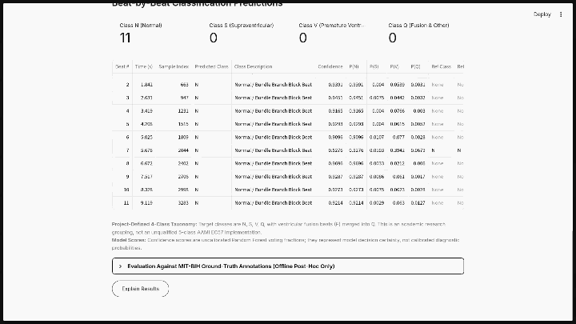
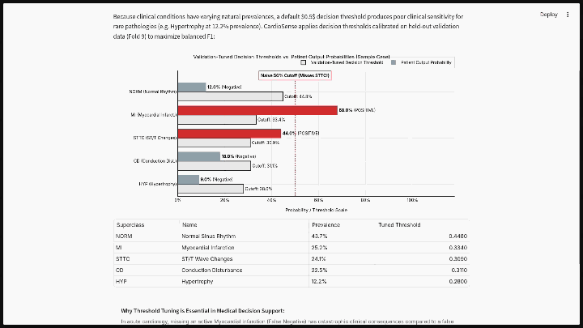
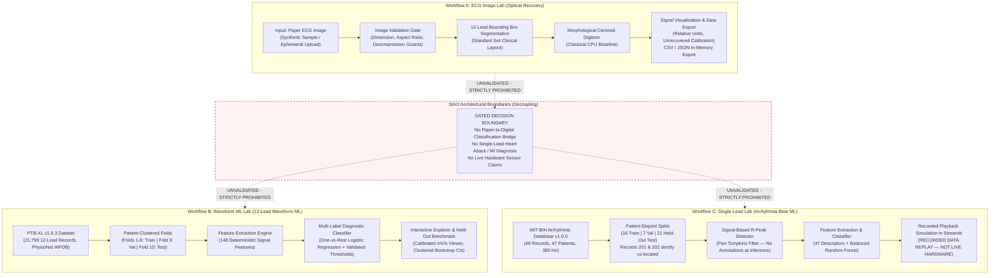
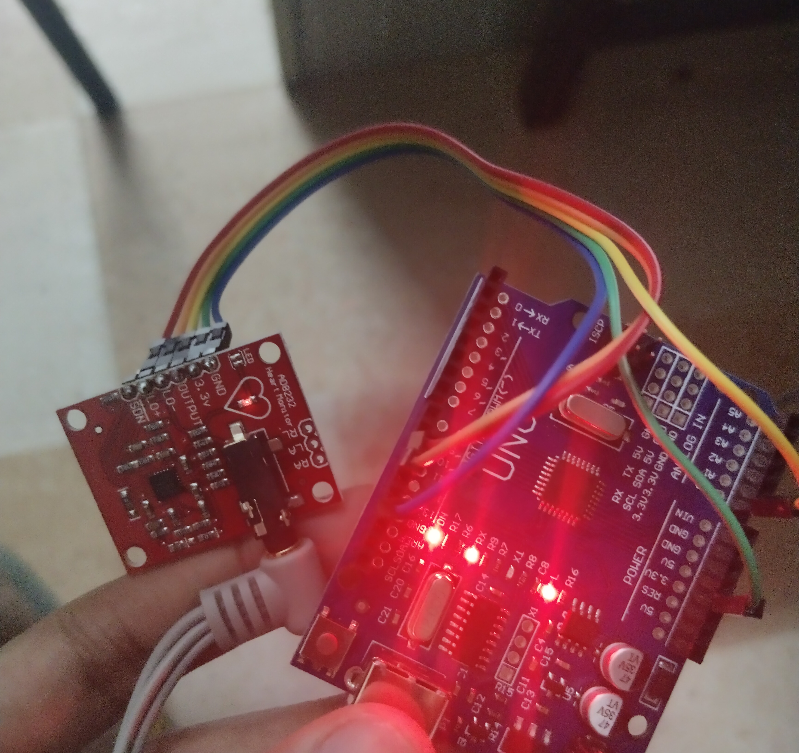
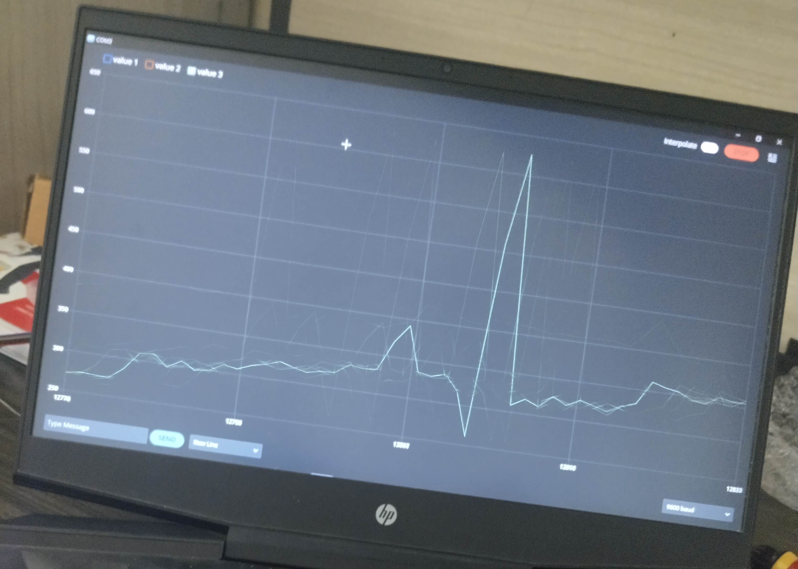
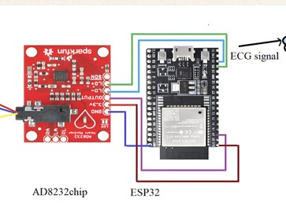

# ECG Insight Lab (CardioSense) — Research Platform

**Academic Research Prototype for Paper ECG Image Digitization & Calibrated Waveform ML**  
*A transparent, leak-free framework bridging historical paper electrocardiograms and reproducible physiological machine learning.*

[](https://www.python.org/)
[](https://opensource.org/licenses/MIT)
[](tests/)
[](app.py)
[](artifacts/waveform_ml/waveform_lr_model.joblib.manifest.json)

---

## 1. Project Motivation & Scope

Electrocardiograms (ECGs) remain the diagnostic cornerstone of cardiac electrophysiology. However, millions of legacy ECG records exist only on physical paper grids or scanned images, while modern predictive algorithms operate on continuous multi-channel digitized voltages. Bridging these paradigms requires rigorous engineering, honest uncertainty quantification, and strict scientific boundaries.

**ECG Insight Lab** is an open-source, software-only research platform developed to:
1. Systematically investigate the algorithmic feasibility, error profiles, and calibration limits of extracting continuous 1D physiological time-series from standard 12-lead paper ECG images.
2. Establish a reproducible, transparent, leak-free benchmark for multi-label cardiac diagnostic classification on digitized waveforms from PhysioNet's public **PTB-XL v1.0.3** dataset.
3. Establish an independent single-channel arrhythmia beat classification pipeline on PhysioNet's **MIT-BIH Arrhythmia Database v1.0.0** featuring an autonomous signal-based R-peak detector and simulated Holter playback (`RECORDED DATA REPLAY — NOT LIVE HARDWARE`).
4. Provide a publication-grade, privacy-first editorial user interface for interactive inspection, diagnostics, and pedagogical demonstration.

### Non-Clinical Research Disclaimer
> [!IMPORTANT]
> **Research Prototype Only — Not for Clinical Use:**  
> This software is designed strictly for academic exploration and scientific methodology benchmarking. It is **not** a certified medical device (FDA 510(k), CE mark, or equivalent) and must **never** be used for clinical diagnosis, patient triage, risk stratification, or healthcare treatment decisions. No physical patient sensors or embedded hardware (such as ESP32 or AD8232) are connected or required.

---

## 2. Authentic Visual Figures & Demonstration Assets

All figures embedded below are genuinely produced from actual project data and reproducible code:

### Optical 12-Lead Digitization Recovery vs. Ground Truth (Workflow A)

*Figure 1: Reconstructed continuous waveforms (solid green) vs. known ground truth (dashed grey) across all 12 leads on the deterministic synthetic benchmark (`sample_data/synthetic_12lead.png`). Mean Pearson $r = 0.6932$, Mean MAE $= 0.0725$ relative units.*

---

### Calibrated 12-Lead Digital ECG Waveform from PTB-XL (Workflow B)

*Figure 2: Authentic 10-second 12-lead digital ECG recording (`00001_lr`) from PTB-XL v1.0.3 sampled at 100 Hz, with physical axes calibrated in seconds and millivolts.*

---

### Held-Out Benchmark Performance & Paired Comparison (Fold 10, $N=2,198$)
| Model Performance on Fold 10 | Paired Patient-Cluster Bootstrap Distribution |
| :---: | :---: |
|  |  |
| *Figure 3: Full-fold model F1 & PR-AUC vs. pilot model across 5 diagnostic superclasses.* | *Figure 4: Paired difference in Macro F1 ($\Delta = +0.1510$, $95\%$ CI $[0.1343, 0.1681]$, $B=2,000$).* |

*For visual walkthroughs of the Streamlit web application, consult [docs/ui_capture_guide.md](docs/ui_capture_guide.md).*

---

### Interactive Application Video Demonstrations

The complete interactive research interface can be observed in real time across the two core platform modes. The animated walkthroughs below play automatically in GitHub; click either animation or the direct links to watch the full 1080p high-definition recording in GitHub's native video player.

#### 1. Practical Lab & Live Experiment Walkthrough (`lab.mp4`)
*Demonstrates interactive 12-lead signal exploration, zero-phase filtering and Bode response, diagnostic superclass inference, confusion matrices, single-lead MIT-BIH Holter beat classification, and LLM clinical explanations.*

[](https://github.com/omkar703/ECG_Insight_Lab_CardioSense/blob/main/docs/assets/lab.mp4)

> [!TIP]
> **▶ [Click here to watch the full 1080p video with audio in GitHub's native video player (`docs/assets/lab.mp4`)](https://github.com/omkar703/ECG_Insight_Lab_CardioSense/blob/main/docs/assets/lab.mp4)**.

---

#### 2. Guided Educational Demo Walkthrough (`demo_guide.mp4`)
*Demonstrates the 9-step pedagogical walkthrough covering cardiac electrophysiology, data leakage prevention, signal conditioning, decoupled machine learning architectures, and calibrated diagnostic decision cutoffs.*

[](https://github.com/omkar703/ECG_Insight_Lab_CardioSense/blob/main/docs/assets/demo_guide.mp4)

> [!TIP]
> **▶ [Click here to watch the full 1080p video with audio in GitHub's native video player (`docs/assets/demo_guide.mp4`)](https://github.com/omkar703/ECG_Insight_Lab_CardioSense/blob/main/docs/assets/demo_guide.mp4)**.

---

## 3. Core Architectural Principles & System Design



### Architectural Tenets
1. **Strict Subsystem Decoupling:**
   - **Workflow A (ECG Image Lab):** Ingestion, format/resolution validation, 12-lead segmentation, and 1D continuous waveform extraction. Calibration status is honestly designated as `UNRECOVERED` with `RELATIVE` amplitude units unless physical grid spacing is verified.
   - **Workflow B (Waveform ML Lab):** Digital waveform feature extraction and diagnostic classification across 5 SCP-ECG superclasses (`NORM`, `MI`, `STTC`, `CD`, `HYP`) trained and evaluated on official patient-stratified partitions.
   - **Workflow C (Single-Lead Beat Lab):** Single-channel beat-type classification using a project-defined 4-class beat grouping (`N`, `S`, `V`, `Q`, with ventricular fusion beats `F` merged into `Q`; not a standard five-class AAMI EC57 implementation) on MIT-BIH Holter data, autonomous Pan-Tompkins QRS detection, and simulated recorded playback.
   - **Hardware Prototype (Phase 7 & 7.1):** Self-contained firmware, schematics, host protocol, offline simulator, and dedicated Streamlit simulation UI (`Hardware Prototype — Offline AD8232 Simulation`) under [`hardware/`](hardware/README.md). Operates completely offline with simulated 10-bit ADC transport, protocol serialization/parsing, simulator inverse conversion, visible per-beat predictions, and post-hoc reference evaluation. Raw ADC counts are never fed into ML classifiers.
2. **Gated Integration Boundary:** Optical digitizer outputs and uncalibrated hardware ADC counts are **not** routed into either classifier, and single-lead signals are never used to predict acute coronary syndrome (MI/STTC/CD/HYP).
3. **Cryptographic Model Trust:** Model serialization uses SHA-256 sidecar manifests (`waveform_lr_model.joblib.manifest.json`, `single_lead_rf_model.joblib.manifest.json`). Untrusted legacy pickles are strictly quarantined in `legacy/` and rejected by code policy.
4. **Zero-Persistence Privacy:** Uploaded images and signals are processed entirely in volatile RAM buffers (`BytesIO`). No files, logs, or patient identifiers are ever written to disk or transmitted across networks.
5. **Quiet Academic Editorial Interface:** A distraction-free visual environment designed according to research editorial standards (warm ivory `#F7F6F2`, deep charcoal `#252722`, and forest green `#455D4A`).

---

## 4. Benchmark Results & Verification

### Optical Digitization Benchmark (Workflow A)
Evaluated on the deterministic synthetic 12-lead benchmark fixture (`sample_data/synthetic_12lead.png` vs. `sample_data/synthetic_12lead_gt.csv`):

| Evaluation Metric | Measured Value | Acceptance Threshold | Status |
| :--- | :---: | :---: | :---: |
| **12-Lead Detection Rate** | **12 / 12 (100%)** | $\ge 10 / 12$ leads | **PASS** |
| **Mean Pearson Correlation ($r$)** | **0.6932** | $> 0.60$ | **PASS** |
| **Mean Absolute Error (MAE)** | **0.0725** (relative units) | $< 0.15$ | **PASS** |
| **Inference Latency (CPU)** | **$\approx 210\,\text{ms}$** | $< 2,000\,\text{ms}$ | **PASS** |
| **Calibration Status** | `UNRECOVERED` | Honest designation | **PASS** |

> [!NOTE]
> **Synthetic Benchmark Caveat:**  
> This benchmark utilizes a project-generated synthetic image with mathematically generated wavelets. It measures algorithmic trace recovery mechanics and does not measure generalization to complex, noisy real-world paper hospital ECG scans.

---

### Waveform Machine Learning Benchmark (Workflow B)
Evaluated across all **2,198 records** ($1,904$ distinct patients) in the held-out **PTB-XL Fold 10** test partition:

| Diagnostic Superclass | Positive Support | Decision Threshold | Precision | Recall | F1-Score | PR-AUC |
| :--- | :---: | :---: | :---: | :---: | :---: | :---: |
| **NORM** (Normal ECG) | 963 | 0.50 | 0.6995 | 0.8484 | **0.7668** | 0.8128 |
| **MI** (Myocardial Infarction) | 550 | 0.50 | 0.4708 | 0.6891 | **0.5594** | 0.5468 |
| **STTC** (ST/T Changes) | 521 | 0.55 | 0.5173 | 0.7159 | **0.6006** | 0.5856 |
| **CD** (Conduction Disturbance) | 496 | 0.55 | 0.5581 | 0.6492 | **0.6002** | 0.6671 |
| **HYP** (Hypertrophy) | 262 | 0.65 | 0.4520 | 0.6107 | **0.5195** | 0.5338 |
| **Macro Average** | 2,198 | — | 0.5633 | 0.6667 | **0.6093** | 0.6292 |
| **Micro Average** | 2,198 | — | 0.5828 | 0.7077 | **0.6392** | — |

---

### Paired Model Comparison & Statistical Methodology
In Phase 3.2.1, a paired patient-cluster bootstrap analysis ($B = 2,000$ replicates, random seed 42) was conducted on the exact same Fold 10 test cohort ($N=2,198$) between the Phase 3.1 Pilot Model and the Phase 3.2 Full-Fold Model:

- **Point Estimates:** Pilot Model Macro F1 = $0.4583$ vs. Full-Fold Model Macro F1 = $0.6093$ ($\Delta = +0.1510$).
- **95% Paired Patient-Clustered Bootstrap CI for Difference:** $[+0.1343, +0.1681]$ ($\text{SE} = 0.0087$).

> [!IMPORTANT]
> **Mandatory Methodological Caveats:**
> 1. **Complete Pipeline Comparison:** The observed $+0.1510$ Macro F1 improvement represents a comparison between two *complete pipelines*. It must not be attributed solely to training set size ($240$ vs. $17,418$ records), because the pilot and full-fold pipelines also utilized different validation sample sizes for threshold tuning ($30$ records vs. $2,183$ records).
> 2. **Empirical Bootstrap Observation:** Exactly `0 of 2,000` paired bootstrap replicates had a non-positive difference ($P \le 0$). This is an empirical observation from finite resampling, not mathematical proof that the probability is exactly zero. The confidence interval describes test-cohort sampling uncertainty conditional on these fixed, fitted models, and does not capture variation across retraining runs.

---

### Single-Lead Beat ML Benchmark (Workflow C)

> [!NOTE]
> **Taxonomy Disclosure:** Project-defined 4-class beat grouping: N, S, V, Q, with ventricular fusion beats (F) merged into Q. This is not a standard five-class AAMI EC57 implementation.<br>
> In evaluated non-paced records, **98.2% of Class Q beats are ventricular fusion beats (`F`)** rather than unclassifiable beats. Evaluated across 21 disjoint held-out patient recordings from the MIT-BIH Arrhythmia Database v1.0.0.

#### 1. Primary Benchmark: Matched-Detection Conditional Beat-Classification Metrics (N = 47,034)
Evaluates beat classification on detected R-peaks proposed by the automated Pan-Tompkins detector, matched to reference annotations within $\pm 50\,\text{ms}$ tolerance ($\pm 18$ samples @ 360 Hz), and retained after feature-window boundary checks:

- **Signal-Based Detector Performance:**
  - **Total Reference Beats:** 47,576
  - **Total Detected Peaks:** 47,163
  - **True Positives (TP):** 47,048 | **False Positives (FP):** 115 | **False Negatives (FN):** 528
  - **Detector Sensitivity:** **98.89%** | **Detector PPV:** **99.76%** | **Detector F1-Score:** **99.32%**
- **Evaluated Detections (Feature-Valid):** **47,034 beats** (47,048 matched detections minus 14 boundary-truncated beats)
- **Primary Accuracy Metrics:**
  - **Macro F1-Score:** **0.5274**
  - **Weighted F1-Score:** **0.9011**

| Beat Class Grouping | True Support | Precision | Recall | F1-Score | Grouping Description |
| :--- | :---: | :---: | :---: | :---: | :--- |
| **N** | 41,883 | 0.9592 | 0.9218 | **0.9401** | Normal / Bundle Branch Block Beats (`N`, `L`, `R`, `e`, `j`) |
| **S** | 1,757 | 0.3555 | 0.1793 | **0.2384** | Supraventricular Ectopic Beats (`A`, `a`, `J`, `S`) |
| **V** | 3,018 | 0.7781 | 0.9298 | **0.8472** | Ventricular Ectopic Beats (`V`, `E`) |
| **Q** | 376 | 0.0489 | 0.2979 | **0.0840** | Ventricular Fusion (`F`) & Unclassifiable (`Q`) |
| **Macro Average** | **47,034** | **0.5354** | **0.5822** | **0.5274** | Unweighted mean across all 4 classes |
| **Weighted Average** | **47,034** | **0.9178** | **0.8896** | **0.9011** | Prevalence-weighted mean |

> [!NOTE]
> **Benchmark Interpretation Note:** Matched-detection conditional beat-classification metrics — classification F1 is calculated only for detector peaks matched to a reference annotation and retained after feature-window boundary checks. Detector false positives (115 peaks) and missed reference beats (542 beats, including boundary-dropped matched beats) are reported separately in detector/count-reconciliation metrics and are not included as errors in this classifier confusion matrix.

#### 2. Secondary Benchmark: Annotation-Centred (Oracle) Classifier Reference
Diagnostic reference isolating classifier feature discrimination assuming ideal QRS localization. Beat windows are centred on expert ground-truth annotation indices (47,561 valid windows after dropping 15 boundary reference annotations); **this is not an autonomous end-to-end result**:

| Beat Class Grouping | Reference Support | Precision | Recall | F1-Score | Baseline F1 |
| :--- | :---: | :---: | :---: | :---: | :---: |
| **N** (Normal / BBB Beat) | 42,184 | 0.9595 | 0.9247 | **0.9418** | 0.9401 |
| **S** (Supraventricular Ectopic / PAC) | 1,782 | 0.4035 | 0.2043 | **0.2712** | 0.0000 |
| **V** (Ventricular Ectopic / PVC) | 3,201 | 0.7912 | 0.9222 | **0.8517** | 0.0000 |
| **Q** (Ventricular Fusion & Other) | 394 | 0.0549 | 0.3173 | **0.0936** | 0.0000 |
| **Macro Average** | **47,561** | **0.5523** | **0.5921** | **0.5396** | 0.2350 |
| **Weighted Average** | **47,561** | **0.9192** | **0.9002** | **0.9036** | 0.8338 |

#### 3. Beat Count Reconciliation & Key Limitations
- **Beat Count Reconciliation:** Total reference annotations in 21 test records = $47,576$.
  - *Oracle Benchmark ($N=47,561$):* 15 reference annotations occur too close to recording edges ($<90$ samples at start or $>649,890$ samples at end: 14 Class N, 1 Class V in Record 233) to extract a complete 200-sample window ($47,576 - 15 = 47,561$).
  - *Detector Benchmark ($N=47,034$):* Pan-Tompkins detects 47,163 peaks; 47,048 match reference annotations within $\pm 50\,\text{ms}$. Of these, 14 fall too close to recording boundaries to extract features ($47,048 - 14 = 47,034$).
  - *Decomposition of the 542 Unrepresented Reference Beats:* 527 non-boundary detector FNs + 1 boundary detector FN (Record 213, sample 649,992, Class N) + 14 boundary-dropped matched detections (13 Class N, 1 Class V) = **542 unrepresented reference beats**.
    - Class N: 301 non-boundary FNs + 1 boundary FN + 13 boundary-dropped detections = **315** unrepresented beats ($42,198 - 315 = 41,883$ true support).
    - Class S: 25 non-boundary FNs = **25** unrepresented beats ($1,782 - 25 = 1,757$ true support).
    - Class V: 183 non-boundary FNs + 1 boundary-dropped detection = **184** unrepresented beats ($3,202 - 184 = 3,018$ true support).
    - Class Q: 18 non-boundary FNs = **18** unrepresented beats ($394 - 18 = 376$ true support).
    Non-boundary FNs total $301 + 25 + 183 + 18 = 527$.
- **Severe Class Imbalance:** Class N represents ~89% of beats, which elevates Weighted F1 (~0.90) relative to Macro F1 (~0.53).
- **Minority Class Performance:** Supraventricular ectopic beats (S: F1 = 0.2384) and Fusion/Other beats (Q: F1 = 0.0840) exhibit poor sensitivity and high false-alarm rates.
- **Academic Replay Boundary:** Workflow C evaluates historic Holter data (1975–1979) and has not been validated on physical AD8232/ESP32 hardware or for clinical monitoring.

> [!CAUTION]
> **RECORDED DATA REPLAY — NOT LIVE HARDWARE:**<br>
> MIT-BIH recordings are digitized Holter cassette recordings from 1975–1979. They do **not** represent live sensor acquisition from AD8232 or ESP32 hardware. Single-lead ECG signals cannot diagnose myocardial infarction or replace 12-lead clinical diagnostics.

### Hardware Prototype & Offline Simulation (Planned AD8232 + Arduino Uno)

A self-contained hardware engineering module is provided under [`hardware/`](hardware/README.md) for future benchtop prototyping:
- **Firmware Sketch (`hardware/firmware/`):** Line-oriented 115,200 baud UART acquisition at nominal 360 Hz with microsecond scheduling.
- **Editable Wiring Schematics (`hardware/diagrams/`):** Vector SVG schematic ([`ad8232_arduino_uno_wiring.svg`](hardware/diagrams/ad8232_arduino_uno_wiring.svg)) and pin mapping table.
- **Offline Stream Simulator (`hardware/host/`):** Generates identical UART data frames from MIT-BIH records or mathematical synthetic fixtures without hardware.
- **Signal Processing & Guards (`hardware/signal_processing/`):** Zero-phase offline filters, causal streaming filters, and calibration guardrails strictly preventing uncalibrated ADC counts from entering ML models.
- **Biomedical Safety:** Standard USB connections lack galvanic isolation (IEC 60601-1); electrode connection to human subjects is strictly prohibited.

#### Hardware Prototype Benchtop Setup & Real-Time Serial Stream Evidence

Experimental benchtop verification of the AD8232 analog front-end and real-time UART serial data transmission:

| AD8232 to Arduino Uno Setup | Live ADC Waveform in Serial Plotter | AD8232 & Microcontroller Wiring Schematic |
| :---: | :---: | :---: |
|  |  |  |
| *Figure 5: Physical benchtop prototype — AD8232 single-lead ECG front-end wired to Arduino Uno with active power & lead indicators.* | *Figure 6: Real-time serial acquisition on COM9 (9600 baud) displaying analog P-QRS-T complexes.* | *Figure 7: Microcontroller interface wiring schematic (3.3V, GND, Output ADC, and LO+/LO- leads-off detection).* |

---

## 5. Educational Teaching Labs (Jupyter Notebooks)

The repository provides four interactive, pre-executed teaching notebooks under `notebooks/` designed for professor evaluations and code walkthroughs:

| Notebook | Focus & Educational Content | Execution Guide |
| :--- | :--- | :---: |
| **`00_system_architecture_and_diagnostics.ipynb`** | Historical evolution, baseline audit trail, and decoupled architecture diagram. | [Open Guide](notebooks/README.md) |
| **`01_ecg_image_digitization.ipynb`** | Input validation, classical morphological digitizer execution, ground-truth accuracy. | [Open Guide](notebooks/README.md) |
| **`02_ptbxl_data_and_features.ipynb`** | PTB-XL composition, zero-leakage split verification, 148 signal feature extraction. | [Open Guide](notebooks/README.md) |
| **`03_model_predictions_and_evaluation.ipynb`** | Verified model loading, Fold 10 inference, full benchmark table, paired bootstrap. | [Open Guide](notebooks/README.md) |

---

## 6. Installation & Quick Start

### Prerequisites
- Operating System: Linux, macOS, or Windows
- Python: **3.10, 3.12, or 3.14** (tested and verified on Python 3.14.4)
- Memory: $\ge 1.0\,\text{GiB}$ RAM available

### Step 1: Environment Setup
```bash
# Clone the repository and navigate to the code directory
git clone <repo-url>
cd code

# Create and activate a clean virtual environment
python3 -m venv .venv
source .venv/bin/activate  # On Windows: .venv\Scripts\activate

# Install production dependencies
pip install --upgrade pip
pip install -r requirements.txt
```

### Step 2: Run Automated Quality Gates
Execute the complete test suite:
```bash
pytest -v
```
*Expected Result: 192 passed tests across the full repository (`tests/` and `hardware/tests/`).*

### Step 3: Run System Diagnostics via CLI
Verify system environment, dataset status, and cryptographic model integrity:
```bash
python -m ecg_lab.waveform_ml.cli diagnostics
```
*Expected Output: All 7 health checks report `[OK]` and system reports `OPERATIONAL`.*

### Step 4: Launch the Full-Stack Web Application
```bash
streamlit run app.py
```
*Open your web browser at `http://localhost:8501`. The web platform provides a streamlined two-part experience:*
1. **Research Guide:** Step-by-step walkthrough of cardiac electrophysiology, noise filtration, Pan-Tompkins QRS cascade, ML architectures, and audited benchmark results.
2. **Practical Lab:** Direct backend-connected interactive workspace to inspect continuous 12-lead voltage heatmaps, cross-lead correlation matrices, execute ML classifiers on PTB-XL records, and analyze single-lead beat morphology.

### Step 5: (Production) Containerized Docker Deployment
Run the complete application as a containerized service with mounted datasets:
```bash
# Using Docker Compose
docker compose up -d --build

# Or using standard Docker CLI
docker build -t cardiosense-ecg-lab .
docker run -d -p 8501:8501 -v "$(pwd)/data:/app/data" -v "$(pwd)/artifacts:/app/artifacts:ro" cardiosense-ecg-lab
```
*For detailed cloud deployment configurations (AWS, GCP, Render, Railway, Hugging Face Spaces), see [docs/deployment_guide.md](docs/deployment_guide.md).*

### Step 6: (Optional) Run Educational Notebooks
```bash
# Install notebook dependencies and register the kernel
pip install -r requirements-notebooks.txt
python -m ipykernel install --user --name ecg-insight-lab --display-name "Python (ECG Insight Lab)"

# Launch JupyterLab
jupyter lab notebooks/
```

---

## 7. Command Line Interface (CLI) Guide

The unified CLI provides reproducible commands for the entire data and ML pipeline:

```bash
# 1. Run system diagnostics and health audit
python -m ecg_lab.waveform_ml.cli diagnostics

# 2. Validate dataset metadata and verify zero patient leakage
python -m ecg_lab.waveform_ml.cli validate --verify-checksums

# 3. Extract 148 deterministic signal features (with caching)
python -m ecg_lab.waveform_ml.cli extract-features

# 4. Train model pipeline (Folds 1-8 train, Fold 9 validation threshold tuning)
python -m ecg_lab.waveform_ml.cli train

# 5. Evaluate frozen model on held-out test fold (Fold 10)
python -m ecg_lab.waveform_ml.cli evaluate

# 6. Audit paired model comparison on Fold 10
python -m ecg_lab.waveform_ml.cli audit-paired-comparison
```

---

## 8. Repository Structure & File Schema

A complete classification of tracked source code, gitignored raw datasets, and quarantined legacy artifacts is detailed in [docs/project_file_schema.md](docs/project_file_schema.md):

```text
code/
├── app.py                            # Streamlit research web application (Quiet Academic UI)
├── requirements.txt                  # Production dependencies
├── requirements-notebooks.txt        # Optional notebook dependencies
├── ecg_lab/                          # Core modular package (digitization, waveform_ml, single_lead_ml, explanations)
├── notebooks/                        # 4 computational research notebooks & guide
├── tests/                            # 146 unit & integration tests across 14 suites
├── hardware/                         # AD8232 + Arduino Uno prototype, simulation & 46 tests
├── sample_data/                      # Synthetic 12-lead benchmarks & MIT-BIH sample records
├── docs/                             # Technical reports, audits & release specifications
│   ├── assets/                       # Publication-grade authentic scientific figures
│   ├── reports/                      # 16 formal engineering milestone reports
│   ├── audit_report.md               # Technical baseline audit report
│   ├── model_card.md                 # 12-lead PTB-XL model card
│   ├── single_lead_model_card.md     # Single-lead MIT-BIH beat model card
│   ├── data_sources_and_licenses.md  # Data provenance & software licenses
│   ├── deployment_guide.md           # Deployment guide & containerization
│   ├── project_file_schema.md        # Full repository taxonomy
│   └── ui_capture_guide.md           # Visual walkthrough & UI guide
├── artifacts/                        # Trained models (12-Lead LR, Single-Lead RF) & SHA-256 manifests
├── legacy/                           # Quarantined legacy pickle models (loading blocked)
└── data/                             # [GITIGNORED] PTB-XL and MIT-BIH raw datasets
```

---

## 9. Data Privacy & Safe Demo Protocol

### Zero-Persistence Privacy Guarantee
- **In-Memory Only:** When an image is uploaded in the ECG Image Lab, it is validated and processed entirely within Python memory buffers (`BytesIO`).
- **No Disk Retention:** Uploaded images and extracted waveforms are never written to disk, cached to persistent storage, or sent to external logging services.
- **De-identification:** No protected health information (PHI) or personal data is collected or handled.

### Safe Demo Mode
- **No Hardware Needed:** The application runs out of the box using built-in synthetic fixtures (`sample_data/synthetic_12lead.png`).
- **Clear Synthetic Labeling:** All synthetic signals are prominently marked `SYNTHETIC DEMO — NOT PATIENT DATA`.
- **No Fabricated Predictions:** Model predictions are disabled for synthetic inputs unless explicitly authorized by experimental code policy.

---

## 10. Academic Provenance, Licensing & Citations

### Open-Source License
The application codebase and documentation are licensed under the [MIT License](LICENSE).

### Data & Literature Citations
- **PTB-XL ECG Dataset:**  
  Wagner, P., Strodthoff, N., Bousseljot, R. D., Kreiseler, D., Lunze, F. I., Samek, W., & Schaeffter, T. (2020). *PTB-XL, a large publicly available electrocardiography dataset*. Scientific Data, 7(1), 154. [https://doi.org/10.1038/s41597-020-0495-6](https://doi.org/10.1038/s41597-020-0495-6). Distributed under [CC BY 4.0](https://creativecommons.org/licenses/by/4.0/).
- **PhysioNet Repository:**  
  Goldberger, A., et al. (2000). *PhysioBank, PhysioToolkit, and PhysioNet: Components of a new research resource for complex physiologic signals*. Circulation, 101(23), e215–e220. [https://doi.org/10.1161/01.CIR.101.23.e215](https://doi.org/10.1161/01.CIR.101.23.e215).
- **MIT-BIH Arrhythmia Database:**  
  Moody, G. B., & Mark, R. G. (2001). *The impact of the MIT-BIH Arrhythmia Database*. IEEE Engineering in Medicine and Biology Magazine, 20(3), 45–50. [https://doi.org/10.1109/51.932724](https://doi.org/10.1109/51.932724).
- **Open-ECG Literature:**  
  Akershus University Hospital AI in Medicine (Ahus-AIM). *Electrocardiogram-Digitization*. Evaluated under [CC BY-SA 4.0](https://creativecommons.org/licenses/by-sa/4.0/).

For detailed dependency licenses, see [docs/data_sources_and_licenses.md](docs/data_sources_and_licenses.md).
