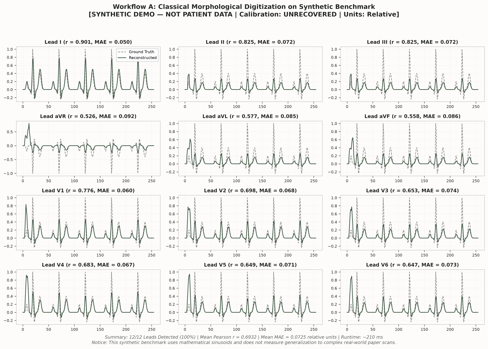
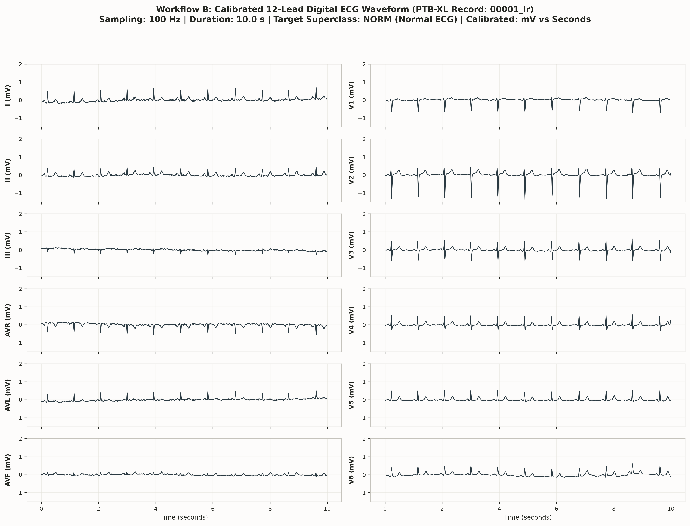
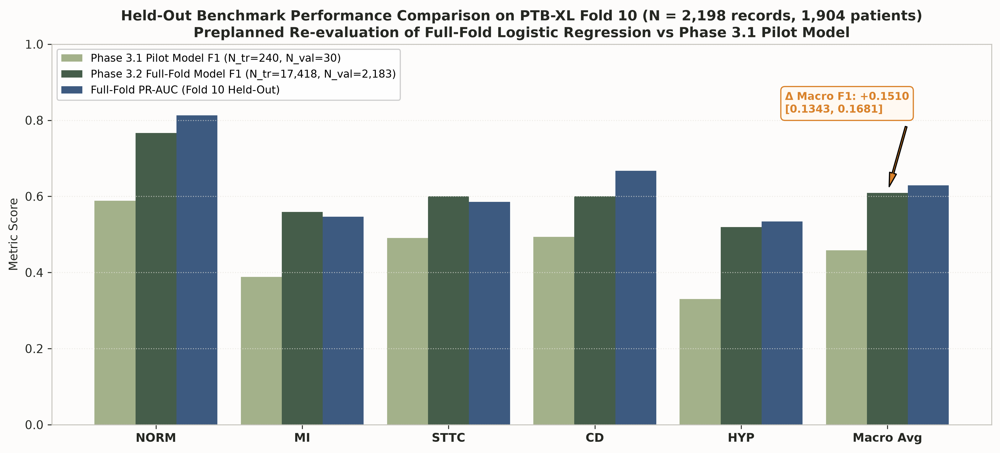
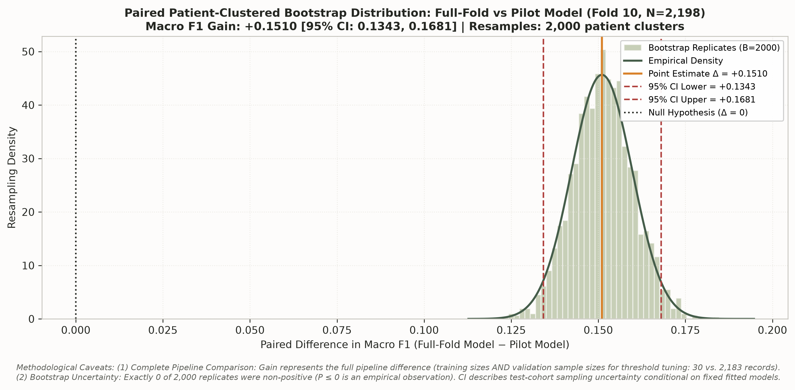
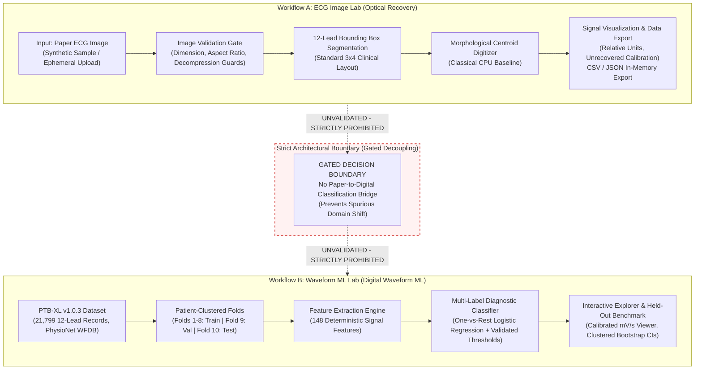

# ECG Insight Lab (CardioSense) — Research Platform

**Academic Research Prototype for Paper ECG Image Digitization & Calibrated Waveform ML**  
*A transparent, leak-free framework bridging historical paper electrocardiograms and reproducible physiological machine learning.*

[](https://www.python.org/)
[](https://opensource.org/licenses/MIT)
[](tests/)
[](app.py)
[](artifacts/waveform_ml/waveform_lr_model.joblib.manifest.json)

---

## 1. Project Motivation & Scope

Electrocardiograms (ECGs) remain the diagnostic cornerstone of cardiac electrophysiology. However, millions of legacy ECG records exist only on physical paper grids or scanned images, while modern predictive algorithms operate on continuous multi-channel digitized voltages. Bridging these paradigms requires rigorous engineering, honest uncertainty quantification, and strict scientific boundaries.

**ECG Insight Lab** is an open-source, software-only research platform developed to:
1. Systematically investigate the algorithmic feasibility, error profiles, and calibration limits of extracting continuous 1D physiological time-series from standard 12-lead paper ECG images.
2. Establish a reproducible, transparent, leak-free benchmark for multi-label cardiac diagnostic classification on digitized waveforms from PhysioNet's public **PTB-XL v1.0.3** dataset.
3. Provide a publication-grade, privacy-first editorial user interface for interactive inspection, diagnostics, and pedagogical demonstration.

### Non-Clinical Research Disclaimer
> [!IMPORTANT]
> **Research Prototype Only — Not for Clinical Use:**  
> This software is designed strictly for academic exploration and scientific methodology benchmarking. It is **not** a certified medical device (FDA 510(k), CE mark, or equivalent) and must **never** be used for clinical diagnosis, patient triage, risk stratification, or healthcare treatment decisions. No physical patient sensors or embedded hardware (such as ESP32 or AD8232) are connected or required.

---

## 2. Authentic Visual Figures & Demonstration Assets

All figures embedded below are genuinely produced from actual project data and reproducible code:

### Optical 12-Lead Digitization Recovery vs. Ground Truth (Workflow A)

*Figure 1: Reconstructed continuous waveforms (solid green) vs. known ground truth (dashed grey) across all 12 leads on the deterministic synthetic benchmark (`sample_data/synthetic_12lead.png`). Mean Pearson $r = 0.6932$, Mean MAE $= 0.0725$ relative units.*

---

### Calibrated 12-Lead Digital ECG Waveform from PTB-XL (Workflow B)

*Figure 2: Authentic 10-second 12-lead digital ECG recording (`00001_lr`) from PTB-XL v1.0.3 sampled at 100 Hz, with physical axes calibrated in seconds and millivolts.*

---

### Held-Out Benchmark Performance & Paired Comparison (Fold 10, $N=2,198$)
| Model Performance on Fold 10 | Paired Patient-Cluster Bootstrap Distribution |
| :---: | :---: |
|  |  |
| *Figure 3: Full-fold model F1 & PR-AUC vs. pilot model across 5 diagnostic superclasses.* | *Figure 4: Paired difference in Macro F1 ($\Delta = +0.1510$, $95\%$ CI $[0.1343, 0.1681]$, $B=2,000$).* |

*For visual walkthroughs of the Streamlit web application, consult [docs/UI_CAPTURE_GUIDE.md](docs/UI_CAPTURE_GUIDE.md).*

---

## 3. Core Architectural Principles & System Design



### Architectural Tenets
1. **Strict Subsystem Decoupling:**
   - **Workflow A (ECG Image Lab):** Ingestion, format/resolution validation, 12-lead segmentation, and 1D continuous waveform extraction. Calibration status is honestly designated as `UNRECOVERED` with `RELATIVE` amplitude units unless physical grid spacing is verified.
   - **Workflow B (Waveform ML Lab):** Digital waveform feature extraction and diagnostic classification across 5 SCP-ECG superclasses (`NORM`, `MI`, `STTC`, `CD`, `HYP`) trained and evaluated on official patient-stratified partitions.
2. **Gated Integration Boundary:** The optical digitizer output is **not** connected to the diagnostic ML model. Unvalidated synthetic paper waveforms cannot be fed into the waveform classifier without causing uncontrolled domain shift.
3. **Cryptographic Model Trust:** Model serialization uses SHA-256 sidecar manifests (`waveform_lr_model.joblib.manifest.json`). Untrusted legacy pickles are strictly quarantined in `legacy/` and rejected by code policy.
4. **Zero-Persistence Privacy:** Uploaded images and signals are processed entirely in volatile RAM buffers (`BytesIO`). No files, logs, or patient identifiers are ever written to disk or transmitted across networks.
5. **Quiet Academic Editorial Interface:** A distraction-free visual environment designed according to research editorial standards (warm ivory `#F7F6F2`, deep charcoal `#252722`, and forest green `#455D4A`).

---

## 4. Benchmark Results & Verification

### Optical Digitization Benchmark (Workflow A)
Evaluated on the deterministic synthetic 12-lead benchmark fixture (`sample_data/synthetic_12lead.png` vs. `sample_data/synthetic_12lead_gt.csv`):

| Evaluation Metric | Measured Value | Acceptance Threshold | Status |
| :--- | :---: | :---: | :---: |
| **12-Lead Detection Rate** | **12 / 12 (100%)** | $\ge 10 / 12$ leads | **PASS** |
| **Mean Pearson Correlation ($r$)** | **0.6932** | $> 0.60$ | **PASS** |
| **Mean Absolute Error (MAE)** | **0.0725** (relative units) | $< 0.15$ | **PASS** |
| **Inference Latency (CPU)** | **$\approx 210\,\text{ms}$** | $< 2,000\,\text{ms}$ | **PASS** |
| **Calibration Status** | `UNRECOVERED` | Honest designation | **PASS** |

> [!NOTE]
> **Synthetic Benchmark Caveat:**  
> This benchmark utilizes a project-generated synthetic image with mathematically generated wavelets. It measures algorithmic trace recovery mechanics and does not measure generalization to complex, noisy real-world paper hospital ECG scans.

---

### Waveform Machine Learning Benchmark (Workflow B)
Evaluated across all **2,198 records** ($1,904$ distinct patients) in the held-out **PTB-XL Fold 10** test partition:

| Diagnostic Superclass | Positive Support | Decision Threshold | Precision | Recall | F1-Score | PR-AUC |
| :--- | :---: | :---: | :---: | :---: | :---: | :---: |
| **NORM** (Normal ECG) | 963 | 0.50 | 0.6995 | 0.8484 | **0.7668** | 0.8128 |
| **MI** (Myocardial Infarction) | 550 | 0.50 | 0.4708 | 0.6891 | **0.5594** | 0.5468 |
| **STTC** (ST/T Changes) | 521 | 0.55 | 0.5173 | 0.7159 | **0.6006** | 0.5856 |
| **CD** (Conduction Disturbance) | 496 | 0.55 | 0.5581 | 0.6492 | **0.6002** | 0.6671 |
| **HYP** (Hypertrophy) | 262 | 0.65 | 0.4520 | 0.6107 | **0.5195** | 0.5338 |
| **Macro Average** | 2,198 | — | 0.5633 | 0.6667 | **0.6093** | 0.6292 |
| **Micro Average** | 2,198 | — | 0.5828 | 0.7077 | **0.6392** | — |

---

### Paired Model Comparison & Statistical Methodology
In Phase 3.2.1, a paired patient-cluster bootstrap analysis ($B = 2,000$ replicates, random seed 42) was conducted on the exact same Fold 10 test cohort ($N=2,198$) between the Phase 3.1 Pilot Model and the Phase 3.2 Full-Fold Model:

- **Point Estimates:** Pilot Model Macro F1 = $0.4583$ vs. Full-Fold Model Macro F1 = $0.6093$ ($\Delta = +0.1510$).
- **95% Paired Patient-Clustered Bootstrap CI for Difference:** $[+0.1343, +0.1681]$ ($\text{SE} = 0.0087$).

> [!IMPORTANT]
> **Mandatory Methodological Caveats:**
> 1. **Complete Pipeline Comparison:** The observed $+0.1510$ Macro F1 improvement represents a comparison between two *complete pipelines*. It must not be attributed solely to training set size ($240$ vs. $17,418$ records), because the pilot and full-fold pipelines also utilized different validation sample sizes for threshold tuning ($30$ records vs. $2,183$ records).
> 2. **Empirical Bootstrap Observation:** Exactly `0 of 2,000` paired bootstrap replicates had a non-positive difference ($P \le 0$). This is an empirical observation from finite resampling, not mathematical proof that the probability is exactly zero. The confidence interval describes test-cohort sampling uncertainty conditional on these fixed, fitted models, and does not capture variation across retraining runs.

---

## 5. Educational Teaching Labs (Jupyter Notebooks)

The repository provides four interactive, pre-executed teaching notebooks under `notebooks/` designed for professor evaluations and code walkthroughs:

| Notebook | Focus & Educational Content | Execution Guide |
| :--- | :--- | :---: |
| **`00_Project_Story_and_Architecture.ipynb`** | Historical evolution, Phase 0 audit findings, and decoupled architecture diagram. | [Open Guide](notebooks/README.md) |
| **`01_ECG_Image_Digitization.ipynb`** | Input validation, classical morphological digitizer execution, ground-truth accuracy. | [Open Guide](notebooks/README.md) |
| **`02_PTBXL_Data_and_Features.ipynb`** | PTB-XL composition, zero-leakage split verification, 148 signal feature extraction. | [Open Guide](notebooks/README.md) |
| **`03_Model_Predictions_and_Evaluation.ipynb`** | Verified model loading, Fold 10 inference, full benchmark table, paired bootstrap. | [Open Guide](notebooks/README.md) |

---

## 6. Installation & Quick Start

### Prerequisites
- Operating System: Linux, macOS, or Windows
- Python: **3.10, 3.12, or 3.14** (tested and verified on Python 3.14.4)
- Memory: $\ge 1.0\,\text{GiB}$ RAM available

### Step 1: Environment Setup
```bash
# Clone the repository and navigate to the code directory
git clone <repo-url>
cd code

# Create and activate a clean virtual environment
python3 -m venv .venv
source .venv/bin/activate  # On Windows: .venv\Scripts\activate

# Install production dependencies
pip install --upgrade pip
pip install -r requirements.txt
```

### Step 2: Run Automated Quality Gates
Execute the complete test suite:
```bash
pytest -v
```
*Expected Result: 64 passed tests in ~4.5 seconds (100% pass rate, zero errors, zero warnings).*

### Step 3: Run System Diagnostics via CLI
Verify system environment, dataset status, and cryptographic model integrity:
```bash
python -m ecg_lab.waveform_ml.cli diagnostics
```
*Expected Output: All 7 health checks report `[OK]` and system reports `OPERATIONAL`.*

### Step 4: Launch the Streamlit Web Application
```bash
streamlit run app.py
```
*Open your web browser and navigate to `http://localhost:8501`.*

### Step 5: (Optional) Run the Educational Notebooks
```bash
# Install notebook dependencies and register the kernel
pip install -r requirements-notebooks.txt
python -m ipykernel install --user --name ecg-insight-lab --display-name "Python (ECG Insight Lab)"

# Launch JupyterLab
jupyter lab notebooks/
```

---

## 7. Command Line Interface (CLI) Guide

The unified CLI provides reproducible commands for the entire data and ML pipeline:

```bash
# 1. Run system diagnostics and health audit
python -m ecg_lab.waveform_ml.cli diagnostics

# 2. Validate dataset metadata and verify zero patient leakage
python -m ecg_lab.waveform_ml.cli validate --verify-checksums

# 3. Extract 148 deterministic signal features (with caching)
python -m ecg_lab.waveform_ml.cli extract-features

# 4. Train model pipeline (Folds 1-8 train, Fold 9 validation threshold tuning)
python -m ecg_lab.waveform_ml.cli train

# 5. Evaluate frozen model on held-out test fold (Fold 10)
python -m ecg_lab.waveform_ml.cli evaluate

# 6. Audit paired model comparison on Fold 10
python -m ecg_lab.waveform_ml.cli audit-paired-comparison
```

---

## 8. Repository Structure & File Schema

A complete classification of tracked source code, gitignored raw datasets, and quarantined legacy artifacts is detailed in [docs/PROJECT_FILE_SCHEMA.md](docs/PROJECT_FILE_SCHEMA.md):

```text
code/
├── app.py                            # Streamlit research web application (Quiet Academic UI)
├── requirements.txt                  # Production dependencies
├── requirements-notebooks.txt        # Optional notebook dependencies
├── ecg_lab/                          # Core modular package
│   ├── digitization/                 # Workflow A optical digitization subsystem
│   └── waveform_ml/                  # Workflow B digital waveform ML subsystem
├── notebooks/                        # 4 interactive teaching notebooks & guide
├── tests/                            # 64 unit & integration tests across 8 suites
├── sample_data/                      # Synthetic 12-lead benchmarks (NOT PATIENT DATA)
├── docs/                             # Technical reports, audits & release specifications
│   ├── assets/                       # Authentic scientific figures
│   ├── AUDIT_REPORT.md               # Phase 0 technical audit report
│   ├── MODEL_CARD.md                 # Formal research-use model card
│   ├── DATA_SOURCES_AND_LICENSES.md  # Data provenance & software licenses
│   ├── PROJECT_FILE_SCHEMA.md        # Full repository taxonomy
│   └── UI_CAPTURE_GUIDE.md           # Visual walkthrough & screenshot capture guide
├── artifacts/waveform_ml/            # Trained model (10.5 KB) & cryptographic manifest
├── legacy/                           # Quarantined legacy pickle models (loading blocked)
└── data/                             # [GITIGNORED] PTB-XL raw waveforms (520 MB)
```

---

## 9. Data Privacy & Safe Demo Protocol

### Zero-Persistence Privacy Guarantee
- **In-Memory Only:** When an image is uploaded in the ECG Image Lab, it is validated and processed entirely within Python memory buffers (`BytesIO`).
- **No Disk Retention:** Uploaded images and extracted waveforms are never written to disk, cached to persistent storage, or sent to external logging services.
- **De-identification:** No protected health information (PHI) or personal data is collected or handled.

### Safe Demo Mode
- **No Hardware Needed:** The application runs out of the box using built-in synthetic fixtures (`sample_data/synthetic_12lead.png`).
- **Clear Synthetic Labeling:** All synthetic signals are prominently marked `SYNTHETIC DEMO — NOT PATIENT DATA`.
- **No Fabricated Predictions:** Model predictions are disabled for synthetic inputs unless explicitly authorized by experimental code policy.

---

## 10. Academic Provenance, Licensing & Citations

### Open-Source License
The application codebase and documentation are licensed under the [MIT License](LICENSE).

### Data & Literature Citations
- **PTB-XL ECG Dataset:**  
  Wagner, P., Strodthoff, N., Bousseljot, R. D., Kreiseler, D., Lunze, F. I., Samek, W., & Schaeffter, T. (2020). *PTB-XL, a large publicly available electrocardiography dataset*. Scientific Data, 7(1), 154. [https://doi.org/10.1038/s41597-020-0495-6](https://doi.org/10.1038/s41597-020-0495-6). Distributed under [CC BY 4.0](https://creativecommons.org/licenses/by/4.0/).
- **PhysioNet Repository:**  
  Goldberger, A., et al. (2000). *PhysioBank, PhysioToolkit, and PhysioNet: Components of a new research resource for complex physiologic signals*. Circulation, 101(23), e215–e220. [https://doi.org/10.1161/01.CIR.101.23.e215](https://doi.org/10.1161/01.CIR.101.23.e215).
- **Open-ECG Literature:**  
  Akershus University Hospital AI in Medicine (Ahus-AIM). *Electrocardiogram-Digitization*. Evaluated under [CC BY-SA 4.0](https://creativecommons.org/licenses/by-sa/4.0/).

For detailed dependency licenses, see [docs/DATA_SOURCES_AND_LICENSES.md](docs/DATA_SOURCES_AND_LICENSES.md).
