# System Architecture & Technical Specifications

**Project:** CardioSense — ECG Insight Lab  
**Subtitle:** Reproducible Machine Learning and Signal Analysis for ECG Data  
**Architecture Document:** Version 2.0.0  
**Date:** October 2026  

---

## 1. Architectural Philosophy: Decoupled Independent Workflows

CardioSense enforces strict architectural decoupling between its three active workflows and its archived experimental subsystem. This design prevents domain shift, cross-subsystem artifact contamination, and unvalidated diagnostic claims.

```mermaid
flowchart TD
    subgraph WF1["Workflow 1: 12-Lead Waveform ML (PTB-XL)"]
        W1_A["PTB-XL Cohort\n(21,799 Records, 100 Hz WFDB)"] --> W1_B["Zero-Phase Butterworth Filter\n(0.05–40 Hz, θ = 0°)"]
        W1_B --> W1_C["Feature Extraction Engine\n(148 Deterministic Signal Features)"]
        W1_C --> W1_D["One-vs-Rest Logistic Regression\n(Validated Decision Thresholds)"]
        W1_D --> W1_E["Multi-Label Probabilities & Explorer\n(NORM, MI, STTC, CD, HYP)"]
    end

    subgraph WF2["Workflow 2: Single-Lead Beat ML (MIT-BIH)"]
        W2_A["MIT-BIH Arrhythmia Database\n(48 Records, 360 Hz)"] --> W2_B["Signal-Based Pan-Tompkins Detector\n(Cascaded Filters + Moving Window Integrator)"]
        W2_B --> W2_C["Beat Windowing & Timing Features\n(47 Features: RR Dynamics + Morphology)"]
        W2_C --> W2_D["Balanced Random Forest Classifier\n(100 Estimators, Max Depth 12)"]
        W2_D --> W2_E["Beat-by-Beat Classifications\n(N, S, V, Q Families)"]
    end

    subgraph WF3["Workflow 3: Hardware Prototype Simulation (AD8232)"]
        W3_A["Signal Source\n(MIT-BIH Replay or Synthetic Fixture)"] --> W3_B["Forward 10-Bit ADC Simulator\n(Baseline: 512, Gain: 150 cts/mV, Sensor Noise)"]
        W3_B --> W3_C["UART Line Protocol Serialization\n(VAL=<adc>,LO+=<0/1>,LO-=<0/1> @ 115200)"]
        W3_C --> W3_D["Serial Stream Parser & Inversion\n(Error Recovery + Gain Recalibration)"]
        W3_D --> W3_E["Simulation UI & Beat Inferences\n(Shared Inference Engine Pipeline)"]
    end

    subgraph ARCHIVE["Archived / Deprecated Research Modules"]
        direction TB
        AR_A["Optical Paper Digitizer\n(Classical Centroid Recovery)"]
        AR_B["Synthetic Benchmark Fixture\n(r = 0.6932, MAE = 0.0725)"]
        AR_A --- AR_B
    end

    subgraph GATED_BOUNDARY["Gated Verification & Decoupling Boundaries"]
        style GATED_BOUNDARY fill:#fff5f5,stroke:#c53030,stroke-width:2px,stroke-dasharray: 5 5
        GB1["AIR-GAP 1: Optical Pixel Traces ➔ NEVER Routed to ML Classifiers"]
        GB2["AIR-GAP 2: Single-Lead Rhythms ➔ CANNOT Diagnose Acute Infarction (MI)"]
        GB3["AIR-GAP 3: Raw ADC Counts ➔ BLOCKED from Inferences without Calibration"]
        GB4["AIR-GAP 4: Ground Truth ➔ NEVER Accessible to Detectors at Inference"]
    end

    WF1 -.-> GATED_BOUNDARY
    WF2 -.-> GATED_BOUNDARY
    WF3 -.-> GATED_BOUNDARY
    ARCHIVE -.-> GATED_BOUNDARY
```

---

## 2. Core Architectural Subsystems

### 2.1 Workflow 1: 12-Lead Diagnostic Classification (PTB-XL)
- **Ingestion & Caching:** Reads 12-lead digital records using WFDB format. In-memory deterministic hashing generates unique fingerprints (`ptbxl_features_<hash>.npz`).
- **Feature Extraction Engine:** Computes 148 mathematical descriptors across all 12 leads and cross-lead energy ratios. No learned parameters are used in feature engineering.
- **Inference Pipeline:** A frozen scikit-learn pipeline scales features using a training-fit `StandardScaler` and predicts probabilities across 5 superclasses via `LogisticRegression`.
- **Decision Engine:** Validation-calibrated cutoffs determine binary class assignments, allowing multi-label co-occurrence (e.g. MI + CD).

### 2.2 Workflow 2: Single-Lead Arrhythmia Beat Analysis (MIT-BIH)
- **Autonomous Detection Cascade:** Pan-Tompkins QRS peak locator operates directly on continuous 360 Hz voltage signals. Ground-truth annotations are strictly excluded from detection and feature windowing.
- **Feature Schema:** Windowed 200-sample beat segmentation generates 47 descriptors:
  - 5 RR timing descriptors (pre-RR, post-RR, local-RR, and ratios).
  - 10 global morphology statistics (mean, std, skewness, kurtosis, etc.).
  - 12 subsegment energy and amplitude metrics (QRS core, pre-QRS, post-QRS).
  - 20 morphological contour sample points.
- **Classification Engine:** 100-estimator Balanced Random Forest classifying beats into `N`, `S`, `V`, `Q`.
- **Cryptographic Model Verification:** SHA-256 sidecar manifest (`single_lead_rf_model.joblib.manifest.json`) is verified prior to model loading.

### 2.3 Workflow 3: AD8232 Hardware Telemetry Simulation
- **Forward Sensor Simulation:** Encodes continuous signals into 10-bit integer ADC counts ($0 - 1023$) with parameterized baseline offset, gain, Gaussian sensor noise, baseline wander, and mains hum.
- **Protocol Layer:** Generates line-delimited serial strings identical to microsecond-scheduled microcontroller firmware.
- **Parser & Inverse Calibration:** `SerialStreamParser` processes serial strings with corrupt-line resilience and sequence-gap tracking. `simulated_adc_to_voltage` inverts calibration to reconstruct estimated millivolts.
- **Shared Inference Gateway:** Inverted waveforms are passed to `run_single_lead_inference`, ensuring consistent beat predictions between software and simulated hardware telemetry.

### 2.4 Archived Research Subsystem: Optical Paper Digitizer
- **Scope & Isolation:** Relocated to an isolated, collapsible research area.
- **Processing:** Classical morphological operations (adaptive thresholding, Gaussian smoothing, 3x4 bounding-box segmentation, and vertical centroid tracing).
- **Decoupling Guarantee:** Extracted 1D signals are flagged with `UNRECOVERED` calibration and `RELATIVE` amplitude units. A programmatic air-gap prohibits passing these waveforms to downstream ML classifiers.

---

## 3. Explanations Subsystem (Groq / Template Integration)

- **Deterministic Payload Sanitization:** A strict whitelist (`ALLOWED_PAYLOAD_KEYS`) and blacklist filter (`DISALLOWED_KEY_PATTERNS`) ensure that **zero** raw waveform traces, raw images, patient identifiers, or system secrets can ever enter explanation prompts.
- **Deterministic Offline Fallback:** If `GROQ_API_KEY` is not present, the system returns a pre-compiled, structured educational explanation without raising errors or making network calls.
- **Output Governance:** Explanations adhere to a 6-part schema:
  1. Plain-Language Summary (`simple_terms`)
  2. Numerical Metric Explanation (`what_numbers_mean`)
  3. Key Physiological Findings (`what_stands_out`)
  4. Algorithmic Boundaries (`limitations`)
  5. Negative Scope (`what_this_does_not_tell_you`)
  6. Recommended Next Steps (`suggested_next_step`)
- **Non-Prescriptive Constraint:** Prompts explicitly forbid generating medical diagnoses, prescribing treatment, or altering deterministic classification outputs.

---

## 4. Security, Secrets & Privacy Architecture

1. **Zero-Persistence In-Memory Buffering:** Uploaded ECG documents and simulated serial streams are processed exclusively in volatile RAM buffers (`io.BytesIO`). No user data is persisted to disk.
2. **Deterministic Manifest Trust:** Model binaries (`.joblib`) are verified against cryptographically signed SHA-256 sidecar manifests before deserialization. Unsigned or mismatched models are rejected.
3. **Secret Masking:** Exception handlers use regex masks (`sanitize_error_message`) to scrub API keys (`gsk_***`) and Bearer tokens from user-facing error logs.
4. **Environment Isolation:** Datasets (`data/`), virtual environments (`.venv/`), and secrets (`.env`, `secrets.toml`) are strictly excluded via `.gitignore`.
