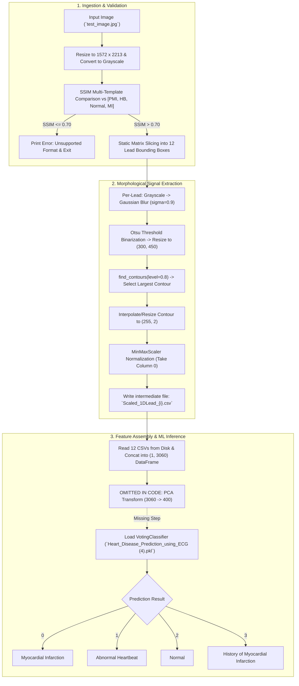
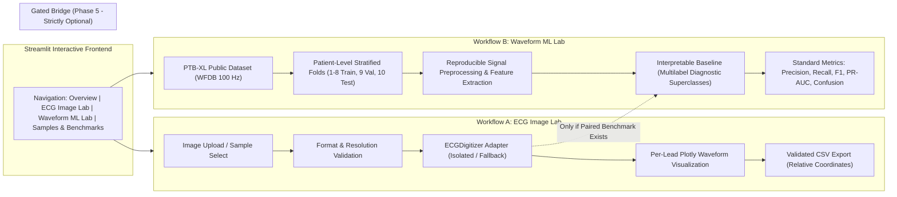

# Phase 0 Audit & Feasibility Report: CardioSense / ECG Insight Lab

**Date of Audit:** October 17, 2026  
**Auditor:** Senior Software Engineer & Technical Auditor (Antigravity)  
**Workspace Root:** `code/` (Relative to `/run/media/op/DATA/Omkar/VIT/2y/3 sem/Project_expo/code`)  
**Companion Documents:** `CardioSense_Antigravity_Build_Plan.md`, `phase_0.md`  

---

## 1. Executive Summary

- **Provisional Go/No-Go Recommendation:** **CONDITIONAL GO for Phase 1 (Foundation & Setup)**, with a **STRICT NO-GO for direct legacy model deployment or clinical/hardware claims**.
- **Scope Alignment:** Confirmed software-only academic prototype. Physical hardware (ESP32/AD8232) is absent from the workspace and will not be claimed or simulated in the MVP.
- **Critical Legacy Inference Bug:** `test.py` extracts 3,060 features ($12 \times 255$) from the ECG image and attempts to pass them directly into a classifier that strictly expects 400 features. The intermediate PCA step is omitted in code.
- **Misidentified PCA Artifact:** `test1.ipynb` failed with `AttributeError: 'PCA' object has no attribute 'predict'` because `finalmodel.pkl` is an `sklearn.decomposition.PCA` transformer, not a classification estimator.
- **Model Redundancy & Provenance Vacuum:** `model_test.pkl` and `Heart_Disease_Prediction_using_ECG (4).pkl` are byte-for-byte identical (SHA256: `95df7354...`). Neither training code, raw training data, class distribution, nor evaluation splits exist in the workspace.
- **Pickle Security & Version Incompatibility:** The legacy models were serialized with `scikit-learn==1.0.1`. Loading them in modern environments triggers compatibility warnings and presents arbitrary code execution risks.
- **Host Runtime Constraints:** The host system runs Python 3.14.4 without `pip` installed and without `git-lfs`. Memory is constrained (7.0 GiB RAM, ~1.2 GiB available).
- **Upstream Digitizer Constraints:** `Open-ECG-Digitizer` is licensed under copyleft **CC BY-SA 4.0** (cannot be vendored into permissive code), requires Python 3.12+, heavy dependencies (PyTorch, Ray, TensorBoard), and 32.3 MB weights hosted on Git LFS.
- **Upstream ML Data Feasibility:** PTB-XL v1.0.3 (PhysioNet, CC BY 4.0, 1.7 GB ZIP) is viable for an independent digital waveform experiment (using 100 Hz signals and standard `strat_fold` splits), but does not provide paired paper scan images.
- **Strict Decoupling Mandate:** The rebuilt application must maintain two completely independent workflows: (A) ECG Image Digitization Lab, and (B) Digital Waveform ML Lab. No diagnostic prediction will be attached to uploaded images without an independently validated end-to-end benchmark.

---

## 2. Scope and Audit Limits

### What Was Inspected
1. **Local Filesystem:** Complete file tree and metadata for `/run/media/op/DATA/Omkar/VIT/2y/3 sem/Project_expo/` including `code/`, `.phase/`, and `ESP32_Detail.docx`.
2. **Code & Notebooks:** Static inspection of Python source code (`test.py`) and stored notebook cells/outputs (`test.ipynb`, `test1.ipynb`).
3. **Binary Model Headers:** Safe binary inspection of opcode headers and class namespaces in `finalmodel.pkl`, `Heart_Disease_Prediction_using_ECG (4).pkl`, and `model_test.pkl` without deserializing Python objects.
4. **Hardware Specifications:** Static review of [ESP32_Detail.docx](file:///run/media/op/DATA/Omkar/VIT/2y/3%20sem/Project_expo/ESP32_Detail.docx).
5. **System Environment:** Linux kernel, OS distribution, CPU/GPU architecture, memory, disk capacity, available Python binaries, and package managers.
6. **External Repositories & Databases:**
   - Open ECG Digitizer GitHub repository: README, LICENSE, `requirements.txt`, `pyproject.toml`, Git LFS weight pointers.
   - PhysioNet PTB-XL v1.0.3 repository: metadata, licensing terms, directory layout, record counts, and download specifications.
   - Scikit-learn official documentation: security and maintainability limitations of model persistence (`model_persistence.html`).

### What Was Deliberately Not Done (Phase 0 Boundaries)
- **No File Modifications:** No existing source code, notebook, image, or document was edited, moved, renamed, or deleted.
- **No Code Execution:** Legacy scripts and notebook cells were not run.
- **No Deserialization:** `.pkl` files were not loaded via `joblib.load()` or `pickle.load()`.
- **No Package Installation:** No system or Python packages were installed; no virtual environments were created.
- **No External Downloads:** Neither the PTB-XL dataset (1.7 GB) nor Open-ECG-Digitizer weights (32.3 MB) were downloaded.
- **No Model Training or Application Build:** No models were fitted, tuned, or deployed.

### Unverified Claims & Unknowns
- **Training Provenance:** Unknown training datasets, patient demographics, ground-truth label definitions, and cross-validation splits used to produce the legacy `.pkl` models.
- **True Accuracy:** Reported historical accuracy claims cannot be verified because no evaluation dataset or evaluation scripts exist in the repository.
- **Generalization:** It is unknown whether the legacy segmentation logic works on any image other than the 4 curated reference images.

---

## 3. Workspace Inventory

All paths are relative to the active workspace folder (`Project_expo/code/`).

| Relative Path | Type | Size | SHA256 Checksum (Prefix) | Status | Purpose / Description |
| :--- | :--- | :--- | :--- | :--- | :--- |
| `test.py` | Python Script | 4.7 KB | `f3dae492...` | Present | Legacy inference pipeline (SSIM check, 12-lead crop, contour extraction, CSV generation, classification). |
| `test1.ipynb` | Jupyter Notebook | 1.49 MB | `d6b67c4c...` | Present | Interactive notebook containing stored plots and error trace showing PCA attribute crash. |
| `test.ipynb` | Jupyter Notebook | 12.5 KB | `f790da3f...` | Present | Duplicate test notebook without embedded plot data. |
| `finalmodel.pkl` | Pickle Artifact | 9.4 MB | `f115c61a...` | Present | Serialized `sklearn.decomposition._pca.PCA` model ($3060 \to 400$ components). |
| `Heart_Disease_Prediction_using_ECG (4).pkl` | Pickle Artifact | 7.6 MB | `95df7354...` | Present | Serialized `GridSearchCV` wrapping ensemble `VotingClassifier` ($N_{\text{features\_in}} = 400$). |
| `model_test.pkl` | Pickle Artifact | 7.6 MB | `95df7354...` | Present | Exact byte-for-byte duplicate of `Heart_Disease_Prediction_using_ECG (4).pkl`. |
| `test_image.jpg` | JPEG Image | 714 KB | `66aad13c...` | Present | Input ECG image scan ($2213 \times 1572$, RGB). |
| `Normal(1).jpg` | JPEG Image | 700 KB | `f1e08f55...` | Present | Reference template for Normal ECG rhythm ($2213 \times 1572$). |
| `MI(1).jpg` | JPEG Image | 703 KB | `283b52ba...` | Present | Reference template for Myocardial Infarction ($2213 \times 1572$). |
| `PMI(1).jpg` | JPEG Image | 697 KB | `84f691cc...` | Present | Reference template for Previous Myocardial Infarction ($2213 \times 1572$). |
| `HB(6).jpg` | JPEG Image | 703 KB | `dcbbacab...` | Present | Reference template for Abnormal Heartbeat ($2213 \times 1572$). |
| `../ESP32_Detail.docx` | Word Document | 40.5 KB | `1a3c90e2...` | Present | Technical report detailing ESP32/AD8232 pinouts and comparing single-lead vs. 12-lead ECG. |
| `../.phase/CardioSense_Antigravity_Build_Plan.md` | Markdown Plan | 22.5 KB | `912072c9...` | Present | Long-term roadmap and architectural guidelines for project refurbishment. |
| `../.phase/phase_0.md` | Markdown Spec | 13.1 KB | `d13473db...` | Present | Strict Phase 0 audit instructions and boundary rules. |

### Missing Files & Assets
- **Git Metadata:** No `.git` folder exists anywhere in `code/` or `Project_expo/`. The project is not under version control.
- **Environment & Dependency Files:** No `requirements.txt`, `environment.yml`, `Pipfile`, or `pyproject.toml`.
- **Training Code:** Zero training scripts or preprocessing notebooks for the `.pkl` models.
- **Ground-Truth Datasets:** No training datasets, test labels, or validation splits.
- **Unit Tests:** No tests, test runners, or validation fixtures exist.
- **Hardware Connection:** No physical ESP32 or AD8232 sensor hardware is attached to the system.

---

## 4. Legacy Architecture

### Key Implementation Specifics:
1. **Static Slicing:** Leads are sliced using fixed pixel windows (e.g. `image[300:600, 150:643]`). A 13th box `image[1250:1480, 150:2125]` is extracted as `Leads[12]` (Lead II rhythm strip) but is completely omitted from the processing loop `for i in range(12)`.
2. **Feature Count:** 12 leads $\times$ 255 points = 3,060 continuous amplitude values.
3. **Disk I/O Anti-Pattern:** The pipeline writes 12 individual CSV files (`Scaled_1DLead_1.csv` to `Scaled_1DLead_12.csv`) to physical disk, immediately re-reads them, and concatenates them.
4. **Classifier Structure:** The classifier is an ensemble `VotingClassifier` combining `SVC`, `KNeighborsClassifier`, `RandomForestClassifier`, `LogisticRegression`, and `GaussianNB`, wrapped inside a `GridSearchCV` container. It explicitly requires 400 features.

---

## 5. Findings and Confirmed Bugs

| ID | Issue Description | Type | Evidence & Details |
| :--- | :--- | :--- | :--- |
| **BUG-01** | **Shape Mismatch in `test.py`** | Confirmed Bug | `combined_data` has 3,060 columns. Model `Heart_Disease_Prediction_using_ECG (4).pkl` has `n_features_in_ = 400`. Passing `combined_data` directly to `predict()` crashes with a feature shape mismatch. |
| **BUG-02** | **PCA `.predict()` Crash in `test1.ipynb`** | Confirmed Bug | Stored notebook cell output shows: `AttributeError: 'PCA' object has no attribute 'predict'` at line 112 when attempting `joblib.load("finalmodel.pkl").predict(combined_data)`. `finalmodel.pkl` is a PCA transformer, not an estimator. |
| **BUG-03** | **Discarded 13th Rhythm Lead** | Confirmed Bug | `Leads[12]` (`image[1250:1480, 150:2125]`) is created on line 53 of `test.py` but is never processed, plotted, or included in feature extraction because loops are bounded at `range(12)`. |
| **BUG-04** | **Unhandled Contour Extraction Failure** | Confirmed Bug | Line 88: `largest_contour = sorted(contours, key=lambda x: x.shape[0], reverse=True)[0]`. If no contour is found above threshold 0.8, `contours` is empty and raises `IndexError: list index out of range`. |
| **BUG-05** | **Intermediate Disk Write Bottleneck** | Confirmed Defect | Lines 98–105 repeatedly write and read CSV files to the physical drive during inference instead of holding arrays in memory. |
| **BUG-06** | **Redundant Large Artifact** | Confirmed Defect | `model_test.pkl` (7.6 MB) is an exact byte-for-byte duplicate of `Heart_Disease_Prediction_using_ECG (4).pkl` (SHA256 identical), wasting storage and creating maintenance ambiguity. |
| **BUG-07** | **Extreme Geometric Fragility** | Confirmed Defect | Fixed pixel crops (`[300:600]`) fail if the image is rotated by even 1 degree, cropped with different margins, or captured from a camera. |
| **BUG-08** | **Missing Version Control** | Confirmed Defect | No Git repository is initialized; changes cannot be tracked, versioned, or rolled back. |
| **BUG-09** | **Complete Provenance Vacuum** | Confirmed Defect | Zero training logs, dataset manifests, or code exist to verify how the models were trained or what accuracy they actually achieved. |

---

## 6. Environment Snapshot

All information collected via safe, read-only system commands on October 17, 2026.

| Parameter | Observed Value | Evaluation & Impact |
| :--- | :--- | :--- |
| **Operating System** | Ubuntu 26.04.1 LTS (Resolute Raccoon), Kernel `7.0.0-38-generic` (x86_64) | Modern Linux distribution. |
| **System Python** | Python 3.14.4 (`/usr/bin/python3.14`) | **Bleeding-edge Python.** Many ML wheels (PyTorch, TensorFlow, legacy Scikit-Learn) lack prebuilt wheels for Python 3.14. |
| **Package Manager** | `pip` is **NOT installed** (`No module named pip`) | `venv` module is available, but `ensurepip` or a package manager must be configured. |
| **System Memory (RAM)** | Total: 7.0 GiB, Available: ~1.2 GiB (Used: 5.8 GiB, Swap: 18 GiB total, 2.2 GiB used) | **Constrained host RAM.** Memory leaks or large in-memory dataset loads will trigger swap thrashing or OOM kills. |
| **Disk Storage** | Mounted at `/run/media/op/DATA`: 218 GB total, 72 GB available (33% free) | Sufficient storage for Phase 1 code, small demo samples, and PTB-XL (1.7 GB). |
| **GPU / Acceleration** | NVIDIA GeForce GTX 1650 Ti Mobile (4,096 MiB VRAM), Driver 595.99.02, CUDA 13.2 | Low-to-mid range mobile GPU (4 GB VRAM). Suitable for small batch inference; marginal for deep training or heavy vision models. |
| **Git LFS** | **NOT INSTALLED** (`git: 'lfs' is not a git command`) | **Blocking for Open-ECG-Digitizer weights.** Cloning repositories using Git LFS yields only 133-byte pointer files. |
| **Workspace Size** | `Project_expo/` total size: ~30 MB | Lightweight directory dominated by pickled models (24.8 MB total). |

---

## 7. External Dependency and Dataset Feasibility

### A. Open ECG Digitizer (`Ahus-AIM/Open-ECG-Digitizer`)
- **License:** **Creative Commons Attribution-ShareAlike 4.0 International (CC BY-SA 4.0)**.
  - *Legal Implication:* CC BY-SA 4.0 is a copyleft license. Any adapted code or combined work must be distributed under the same license terms. **It cannot be directly vendored into a MIT/Apache-2.0 codebase.** It must be executed strictly as an isolated subprocess or external adapter service.
- **Python & Dependencies:** Requires Python 3.12+, PyTorch, TorchVision, TorchAudio, Ray (`[data,train,tune]`), TensorBoard, YACS, Scikit-Image, and SciPy.
- **Model Weights:** Pretrained weights (`lead_name_unet_weights_07072025.pt` = 23.3 MB, `unet_weights_07072025.pt` = 9.0 MB) are tracked via Git LFS.
- **Feasibility on Local Machine:** **HIGH RISK / BLOCKED IN PHASE 0.** The local machine has Python 3.14 (not 3.12), lacks `pip`, lacks `git-lfs`, and has only 1.2 GiB free RAM. Running a Ray cluster and PyTorch segmentation models may exceed available host memory.
- **Recommendation:** Do not attempt full installation in Phase 1. Isolate the digitizer behind an abstract interface (`ECGDigitizer`), provide a deterministic fallback adapter for testing, and conduct a dedicated feasibility spike in Phase 2.

### B. PhysioNet PTB-XL Dataset v1.0.3
- **License:** **Creative Commons Attribution 4.0 International (CC BY 4.0)**. Permissive; allows redistribution and commercial use with citation.
- **Dataset Size & Structure:** 1.7 GB compressed ZIP. Contains 21,801 10-second 12-lead digital records from 18,869 patients.
  - Signal files: WFDB format (16-bit precision), available in downsampled 100 Hz (`records100/`) and full 500 Hz (`records500/`).
  - Metadata: `ptbxl_database.csv` includes age, sex, recording dates, and an official patient-level cross-validation split column (`strat_fold`, folds 1–10).
  - Diagnostic Statements: `scp_statements.csv` maps 71 annotations into 5 superclasses (`NORM`, `MI`, `STTC`, `CD`, `HYP`) and 24 subclasses.
- **Feasibility on Local Machine:** **FEASIBLE.** The 100 Hz signals can be processed easily on CPU within available disk (72 GB free).
- **Critical Scope Restriction:** PTB-XL provides **digital waveforms**, not scanned paper ECG images. It is suitable for the **Waveform ML Lab**, but cannot validate the paper image digitization pipeline.

### C. Scikit-Learn Model Persistence (`scikit-learn.org/stable/model_persistence.html`)
- **Security Guidance:** Official scikit-learn documentation emphasizes that pickle/joblib files can execute arbitrary code during unpickling. Untrusted `.pkl` files must never be unpickled in production.
- **Cross-Version Warnings:** The legacy models were serialized with `scikit-learn==1.0.1`. Loading them in scikit-learn 1.6+ causes `InconsistentVersionWarning` and broken estimators due to private API changes between major versions.
- **Recommendation:** Isolate legacy models in a quarantined `legacy/` directory. Do not use them as the primary inference engine for the refurbished application.

---

## 8. Loophole and Risk Register

| Risk ID | Severity | Evidence | Consequence / Impact | Mitigation Strategy | Phase 1 Blocker? |
| :--- | :--- | :--- | :--- | :--- | :--- |
| **RSK-01** | **HIGH** | `git: 'lfs' is not a git command` | Cloning Open-ECG-Digitizer yields 133-byte pointer files, causing runtime PyTorch load errors. | Install `git-lfs` or download raw weight releases directly via HTTP/curl. | No (Spike deferred to Phase 2) |
| **RSK-02** | **HIGH** | Host has Python 3.14.4; no `pip` installed. | PyTorch, torchvision, and ray do not yet have stable binary wheels for Python 3.14. | Build an isolated virtual environment; evaluate uv or python3-venv with pinned compatible runtime. | **YES (Blocks environment setup)** |
| **RSK-03** | **HIGH** | Available RAM is ~1.2 GiB (Swap: 2.2 GiB used). | Loading heavy PyTorch models or full datasets simultaneously causes OOM kills or severe disk thrashing. | Use 100 Hz PTB-XL subset; batch generator loading; lightweight ML baselines (RandomForest/LogisticRegression). | No (Can be managed by design) |
| **RSK-04** | **HIGH** | Legacy `.pkl` models have no training code or provenance. | Cannot prove accuracy, verify data leakage, or validate clinical claims for academic evaluation. | Relegate legacy models to reference only. Train fresh, reproducible baseline on PTB-XL with documented splits. | No |
| **RSK-05** | **HIGH** | CC BY-SA 4.0 copyleft license on Open-ECG-Digitizer. | Ingesting digitizer code directly into the app forces the entire app under ShareAlike terms. | Treat digitizer as an external subprocess adapter; keep application code modular and cleanly separated. | No |
| **RSK-06** | **MEDIUM** | Fixed bounding box coordinates in `test.py`. | Any mobile photo or scanned ECG with different margins fails or extracts garbage signals. | Document fixed layout as legacy limitation; implement perspective/crop validation in Phase 2. | No |
| **RSK-07** | **MEDIUM** | Project Expo documents mention hardware (AD8232/ESP32), but no hardware exists. | Evaluators will expect live sensor graphs and hardware demonstrations. | Explicitly label application as "Software-Only Research Prototype"; provide clearly marked demo replay data. | No |
| **RSK-08** | **LOW** | Duplicate file `model_test.pkl` (7.6 MB). | Unnecessary disk usage and confusion about which model is canonical. | Document identity in audit report; quarantine duplicate in `legacy/` during Phase 1 reorganization. | No |

---

## 9. Recommended Target Architecture

The application will be refactored into two decoupled, independently testable workflows within a modular Streamlit + Plotly architecture:

### Architectural Safeguards:
1. **No Fake Hardware:** Prerecorded sample traces will be clearly watermarked as `DEMO / PRERECORDED`. No simulated "live" connection indicators.
2. **No Uncalibrated Physical Claims:** Unless physical grid squares ($0.1\,\text{mV} / 0.04\,\text{s}$) are reliably detected, extracted amplitudes will be explicitly displayed in `Normalized / Relative Units`.
3. **No Forced Image-to-Classifier Pipeline:** Image digitization outputs will NOT be fed directly into the PTB-XL classifier without an explicit, validated calibration bridge.

---

## 10. Prioritized Phase 1 Backlog

Phase 1 focuses exclusively on creating a clean, version-controlled foundation, establishing a reproducible Python environment, isolating legacy files, and adding foundational automated tests.

| Task ID | Task Title | Description & Scope | Dependencies |
| :--- | :--- | :--- | :--- |
| **T1.1** | **Git Initialization & Preservation** | Initialize Git repository at `Project_expo/` root; add robust `.gitignore` (ignoring caches, virtualenvs, large data, raw weights); commit initial state as baseline. | None |
| **T1.2** | **Quarantine Legacy Artifacts** | Move historical files (`test.py`, notebooks, `.pkl` models, reference images) into a designated `legacy/` directory without altering their contents. | T1.1 |
| **T1.3** | **Python Environment & Package Setup** | Establish a dedicated, reproducible virtual environment (using `python3 -m venv` or `uv`); configure pip/build tools; pin base dependencies (`streamlit`, `plotly`, `scikit-learn`, `scipy`, `pandas`, `pytest`, `pillow`). | T1.1 |
| **T1.4** | **Modular Package Scaffolding** | Create standard project package layout (`ecg_lab/`, `tests/`, `docs/`, `sample_data/`). | T1.2, T1.3 |
| **T1.5** | **Input Validation & Safety Module** | Implement `ecg_lab/validation.py` to check image format, minimum dimensions, channel count, and file corruption with informative error returns. | T1.4 |
| **T1.6** | **Automated Test Suite (pytest)** | Add unit tests in `tests/test_validation.py` covering valid/corrupt image inputs, missing files, and boundary conditions. | T1.5 |
| **T1.7** | **Documentation & Verification Guide** | Create `README.md` documenting installation, test commands (`pytest`), and project scope. | T1.6 |

---

## 11. Acceptance Criteria for Phase 1 Exit

Before Phase 2 can begin, all of the following measurable conditions must be satisfied and verified:

1. [ ] **Repository Status:** Git repository initialized with a clean working tree; legacy artifacts safely preserved under `legacy/` and tracked in Git history.
2. [ ] **Environment Verification:** A dedicated virtual environment can be activated, and `python -m pip list` confirms all pinned dependencies are installed without conflicts.
3. [ ] **Test Execution:** Running `pytest` from the workspace root passes 100% of unit tests with zero failures or unhandled exceptions.
4. [ ] **Input Validation:** The validation module correctly rejects invalid image types (e.g. non-image text files, truncated JPEGs, images $< 300\times300$ pixels) and returns structured error dictionaries.
5. [ ] **Zero Deserialization:** No legacy `.pkl` file is loaded or imported during test runs.
6. [ ] **Documentation:** `README.md` clearly states the software-only research scope, installation commands, and test instructions.

---

## 12. Owner Decisions Required

The following decisions require explicit owner instruction before Phase 1 implementation begins:

1. **Workspace Root Definition:**
   - *Option A (Recommended):* Treat `/run/media/op/DATA/Omkar/VIT/2y/3 sem/Project_expo` as the repository root so that `.phase/`, documentation, and code live in one unified project structure.
   - *Option B:* Treat `/run/media/op/DATA/Omkar/VIT/2y/3 sem/Project_expo/code` as the root and ignore parent documentation.
   - *Recommendation:* **Option A**.

2. **Python Runtime Strategy:**
   - *Option A (Recommended):* Use the system's `python3 -m venv` with `ensurepip` to set up a clean, isolated environment with wheels compatible with Linux x86_64.
   - *Option B:* Install an external Python version manager (such as `pyenv` or `uv`) to specifically install Python 3.12 (matching Open-ECG-Digitizer).
   - *Recommendation:* **Option A** for Phase 1 baseline; test Option B during the Phase 2 digitizer spike if Python 3.14 wheel incompatibilities arise.

3. **Legacy Artifact Retention:**
   - *Option A (Recommended):* Move all legacy files (`test.py`, `test1.ipynb`, `.pkl` files, images) into a `legacy/` folder to maintain historical academic records while keeping new source files clean.
   - *Option B:* Leave legacy files in place and build new packages around them.
   - *Recommendation:* **Option A**.

4. **Waveform ML Target Task Selection:**
   - *Option A (Recommended):* Use the 5 PTB-XL diagnostic superclasses (`NORM`, `MI`, `STTC`, `CD`, `HYP`) with multilabel evaluation on the official `strat_fold` split.
   - *Option B:* Restrict the task to binary classification (`Normal` vs. `Myocardial Infarction`).
   - *Recommendation:* **Option A** (reflects standard clinical benchmarks and avoids artificial label distortion).

---

## 13. Commands and Evidence

The following read-only commands and web sources were executed and verified during this audit:

### Local Read-Only Terminal Commands:
- `ls -la /run/media/op/DATA/Omkar/VIT/2y/3 sem/Project_expo/.phase`: Confirmed presence of `CardioSense_Antigravity_Build_Plan.md` and `phase_0.md`.
- `pwd && ls -la && ls -la ..`: Inspected project directories and historical files.
- `git status 2>&1; git -C .. status 2>&1`: Verified neither `code/` nor `Project_expo/` is a Git repository (`fatal: not a git repository`).
- `sha256sum * ../ESP32_Detail.docx ../.phase/*`: Verified file checksums and proved identity between `Heart_Disease_Prediction_using_ECG (4).pkl` and `model_test.pkl`.
- `uname -a; cat /etc/os-release`: Detected Ubuntu 26.04.1 LTS on Linux 7.0.0-38-generic x86_64.
- `python3 --version; which python3`: Verified Python 3.14.4 at `/usr/bin/python3`.
- `free -h; df -h .`: Measured 7.0 GiB RAM (1.2 GiB available) and 72 GB free disk on `/run/media/op/DATA`.
- `nvidia-smi 2>&1; lspci | grep -i -E "vga|3d|display"`: Detected NVIDIA GeForce GTX 1650 Ti Mobile (4 GiB VRAM), Driver 595.99.02, CUDA 13.2.
- `git lfs version 2>&1`: Verified Git LFS is missing (`git: 'lfs' is not a git command`).
- `which pip pip3 conda uv poetry pyenv`: Confirmed no package manager binaries currently in user PATH.
- `python3 -m pip --version`: Verified `/usr/bin/python3: No module named pip`.
- `python3 -m venv -h`: Verified `venv` standard library module is available.
- `du -sh /run/media/op/DATA/Omkar/VIT/2y/3 sem/Project_expo`: Measured 30 MB total project footprint.

### Web Sources Inspected:
- `https://raw.githubusercontent.com/Ahus-AIM/Open-ECG-Digitizer/main/README.md`: Verified features, architecture, U-Net semantic segmentation, and perspective detector.
- `https://raw.githubusercontent.com/Ahus-AIM/Open-ECG-Digitizer/main/LICENSE`: Verified Creative Commons Attribution-ShareAlike 4.0 International license.
- `https://raw.githubusercontent.com/Ahus-AIM/Open-ECG-Digitizer/main/requirements.txt`: Verified PyTorch, torchvision, ray, tensorboard, and yacs dependencies.
- `https://raw.githubusercontent.com/Ahus-AIM/Open-ECG-Digitizer/main/weights/lead_name_unet_weights_07072025.pt`: Verified Git LFS pointer (size 23,296,757 bytes).
- `https://raw.githubusercontent.com/Ahus-AIM/Open-ECG-Digitizer/main/weights/unet_weights_07072025.pt`: Verified Git LFS pointer (size 9,046,406 bytes).
- `https://physionet.org/content/ptb-xl/1.0.3/`: Verified 21,801 records, 18,869 patients, CC BY 4.0 license, 1.7 GB ZIP size, and `strat_fold` split guidelines.
- `https://scikit-learn.org/stable/model_persistence.html`: Verified security warnings on arbitrary code execution via pickle and `InconsistentVersionWarning` documentation.
