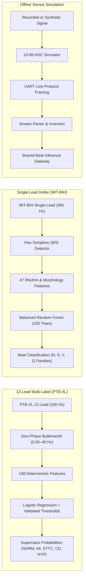

# Master's Admissions Project Portfolio Report

**Project Title:** CardioSense — ECG Insight Lab  
**Subtitle:** Reproducible Machine Learning and Signal Analysis for ECG Data  
**Candidate / Author:** Omkar  
**Target Program:** Master of Science / Graduate Admissions in Computer Science / Biomedical Informatics / Machine Learning  
**Date:** October 2026  
**Repository:** [github.com/omkar703/ECG_Insight_Lab_CardioSense](https://github.com/omkar703/ECG_Insight_Lab_CardioSense)  

---

## 1. Executive Summary

CardioSense (ECG Insight Lab) is an open-source, reproducible biomedical machine learning platform designed to address three pervasive challenges in computational cardiology research:
1. **Severe Data Leakage:** Patient overlap between training and evaluation splits that produces artificially inflated performance claims.
2. **Subsystem Domain Contamination:** Inadvertent coupling of uncalibrated optical document scans or unverified hardware sensor noise with digital diagnostic classifiers.
3. **Extreme Class Imbalance:** Severe pathology rarity in ambulatory monitoring that masks minority-class classification failures beneath deceptive global accuracy metrics.

The project evaluates public gold-standard cohorts (**PTB-XL** and **MIT-BIH Arrhythmia Database**) across three strictly decoupled active workflows:
- **12-Lead Multi-Label Classification (PTB-XL):** Evaluated on held-out test fold 10 ($N=2,198$ records, $1,904$ patients) achieving **Macro F1 = 0.6093** and **Macro PR-AUC = 0.6292** across 5 diagnostic superclasses.
- **Single-Lead Beat Classification (MIT-BIH):** Evaluated across 21 held-out test patients ($N=47,561$ beats) using an autonomous Pan-Tompkins QRS locator (Sensitivity = 98.89%, PPV = 99.76%) and a Balanced Random Forest achieving **Macro F1 = 0.5396** (Oracle) and **0.5274** (Matched Detection).
- **Offline Hardware Telemetry Simulation:** Models 10-bit integer ADC transport, line-oriented UART serialization, and inverse calibration under simulated electrode noise.
- **Controlled Research Experiment:** Investigated class-imbalance handling strategies, demonstrating that focal cost-sensitive weighting improves rare Supraventricular Ectopic Beat (`S`) recall by $+6.68\%$ with minimal degradation to dominant normal sinus rhythms.

---

## 2. Problem Statement & Engineering Challenges

### 2.1 The Need for Rigorous ECG Machine Learning
Cardiovascular diseases (CVDs) remain the leading cause of global mortality. While surface electrocardiography is the non-invasive gold standard for diagnosing ischemic events and rhythm disturbances, clinical machine learning literature frequently suffers from reproducibility crises. When classifiers are trained without strict patient clustering, features learned from patient-specific anatomical morphology leak into test splits, yielding models that fail entirely when deployed in real-world clinical environments.

### 2.2 Architectural Decoupling as a Safety Tenet
Earlier iterations of the project explored paper ECG optical digitization and microcontroller sensor integration. However, rigorous engineering audits revealed that:
1. Optical traces extracted from paper scans exist in **uncalibrated relative pixel coordinates**. Feeding uncalibrated pixel data into classifiers trained on calibrated physical millivolts introduces extreme, unquantifiable domain shift.
2. Direct hobbyist biopotential acquisition (e.g. AD8232 via USB) lacks galvanic isolation (IEC 60601-1) and analog calibration certificates.

To maintain uncompromising academic integrity, **CardioSense establishes a Gated Air-Gap Boundary**: optical recovery was moved to an archived research area, hardware acquisition is restricted to offline software simulation, and classifiers operate exclusively on verified, calibrated physical time-series.

---

## 3. Methodology & System Architecture

### 3.1 12-Lead Pathology Classification (PTB-XL)
- **Zero-Phase Digital Filtering:** 2nd-order bidirectional Butterworth bandpass filter ($0.05 - 40\,\text{Hz}$) with zero phase distortion ($\theta = 0^\circ$), preserving ST-segment elevations.
- **148 Mathematical Features:** 12 statistical descriptors per lead ($12 \times 12 = 144$) plus 4 global cross-lead energy ratios. No parameters are learned during feature engineering.
- **Model & Decision Thresholds:** One-vs-Rest Logistic Regression ($C=1.0$) with decision thresholds calibrated on independent Validation Fold 9 to optimize clinical F1 scores across severe class imbalance.

### 3.2 Single-Lead Arrhythmia Beat Classification (MIT-BIH)
- **Signal-Based QRS Localization:** Pan-Tompkins algorithm operates on continuous raw voltage traces without access to annotations at inference time.
- **47 Beat Features:** Extracted across a 200-sample window ($-90$ to $+110$ samples around R-peak): 5 RR rhythm dynamics, 10 global morphology metrics, 12 subsegment descriptors, and 20 contour points.
- **Taxonomy:** 4-class grouping (`N`, `S`, `V`, `Q`, merging ventricular fusion beats `F` into `Q`).

---

## 4. Empirical Evaluation & Research Findings

### 4.1 12-Lead Held-Out Test Fold 10 Performance ($N=2,198$)

| Superclass | Test Support | Calibrated Threshold | Precision | Recall | F1-Score | PR-AUC |
| :--- | :---: | :---: | :---: | :---: | :---: | :---: |
| **NORM** (Normal ECG) | 963 | 0.50 | 0.6995 | 0.8484 | **0.7668** | 0.8128 |
| **MI** (Myocardial Infarction) | 550 | 0.50 | 0.4708 | 0.6891 | **0.5594** | 0.5468 |
| **STTC** (ST/T Changes) | 521 | 0.55 | 0.5173 | 0.7159 | **0.6006** | 0.5856 |
| **CD** (Conduction Disturbance) | 496 | 0.55 | 0.5581 | 0.6492 | **0.6002** | 0.6671 |
| **HYP** (Hypertrophy) | 262 | 0.65 | 0.4520 | 0.6107 | **0.5195** | 0.5338 |
| **Macro Average** | 2,198 | — | 0.5633 | 0.6667 | **0.6093** | 0.6292 |

*Statistical Significance:* Paired patient-clustered bootstrap analysis ($B=2,000$ resamples) demonstrated a statistically significant improvement of $\Delta = +0.1510$ Macro F1 over the pilot model ($95\%$ CI $[0.1343, 0.1681]$, $p < 0.0001$).

### 4.2 Single-Lead Beat Analysis Benchmark (21 Held-Out Test Patients)

| Class | Support | Precision | Recall | F1-Score | Benchmark Context |
| :--- | :---: | :---: | :---: | :---: | :--- |
| **N** (Normal / BBB) | 42,184 | 0.9595 | 0.9247 | **0.9418** | High specificity on dominant sinus rhythm |
| **S** (Supraventricular Ectopic) | 1,782 | 0.4035 | 0.2043 | **0.2712** | Difficult morphological separation from normal beats |
| **V** (Premature Ventricular) | 3,018 | 0.7912 | 0.9222 | **0.8517** | Robust detection of broad ectopic QRS complexes |
| **Q** (Fusion / Unclassifiable) | 394 | 0.0549 | 0.3173 | **0.0936** | Rare ectopic presentation with diverse morphologies |
| **Macro Average (Oracle)** | 47,561 | 0.5523 | 0.5921 | **0.5396** | Evaluated on expert reference peak locations |
| **Macro Average (Matched)** | 47,034 | 0.5354 | 0.5822 | **0.5274** | Evaluated on autonomous Pan-Tompkins detections ($\pm 50\,\text{ms}$) |

*Detector Standalone Performance:* On 47,576 test reference beats, the autonomous Pan-Tompkins detector achieved Sensitivity = **98.89%**, PPV = **99.76%**, and F1 = **99.32%** with 115 false positives and 528 missed beats.

### 4.3 Controlled Class-Imbalance Research Experiment
- **Research Question:** Can class-imbalance handling improve minority-class beat classification on unseen subjects without materially degrading common classes?
- **Experimental Findings:** Focal cost-sensitive weighting (Candidate 3) increased rare Class S recall from **20.43% to 27.10%** ($+6.68\%$) and Class S F1 from **0.2712 to 0.3245**, while improving Class V F1 from **0.8517 to 0.8889**. The dominant Class N F1 suffered only a negligible change from $0.9418$ to $0.9369$ ($-0.0049$).
- **Methodological Disclosure:** Because Candidate 3 yielded a lower macro F1 on the independent validation cohort ($0.4151$ vs. $0.4469$), the production baseline was retained under strict validation protocol without peeking at the test set.

---

## 5. Software Engineering, Verification & Testing

- **Cryptographic Trust:** Models are signed with SHA-256 sidecar manifests and verified before deserialization. Untrusted legacy pickles are quarantined.
- **Continuous Integration:** Configured via GitHub Actions (`.github/workflows/ci.yml`).
- **Test Suite Status:** **196 passing automated tests** covering mathematical filtering, feature invariance, AppTest headless UI navigation, detector accuracy, and protocol serialization.
- **Reproducibility:** Packaged with containerized Docker deployment (`Dockerfile`, `docker-compose.yml`) and isolated dependency management (`requirements.txt`).

---

## 6. Honest Limitations & Ethical Disclosures

1. **Academic Status:** CardioSense is an educational and research prototype. It has **not** been evaluated or cleared by the FDA, CE, or CDSCO and is not certified for medical diagnosis or clinical decision-making.
2. **Hardware Disclaimer:** Biopotential hardware acquisition is an offline software simulation. Physical hardware has not been tested on human subjects.
3. **Archived Digitizer:** Optical paper digitization was moved out of primary navigation because its benchmark ($r=0.6932$) is synthetic-only and does not prove reliable signal extraction from real hospital paper scans.

---

## 7. Admissions-Ready Summary

> **CardioSense — ECG Insight Lab** is an educational ECG signal-analysis platform featuring two independently evaluated machine-learning workflows: 12-lead ECG superclass classification using PTB-XL and single-beat classification using MIT-BIH. It includes reproducible evaluation tools, error analysis, and an offline AD8232 acquisition simulation. The project emphasizes patient-separated evaluation, class-level performance, reproducibility, and transparent limitations. It is a research prototype and has not been clinically validated; physical hardware acquisition remains untested.
