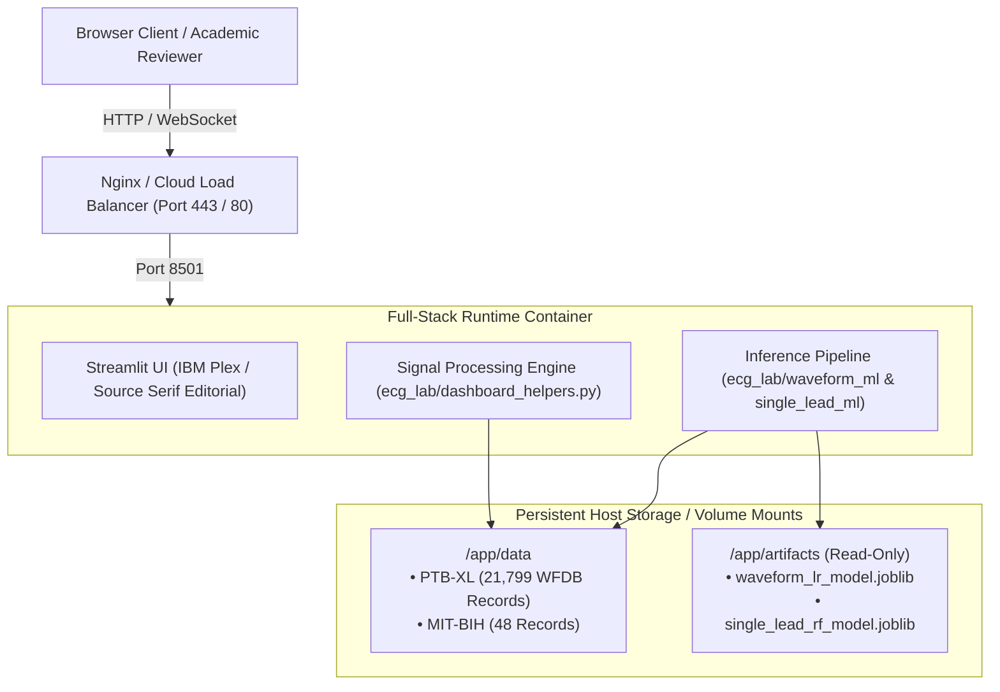

# CardioSense / ECG Insight Lab — Production Deployment Guide

**Target Environment:** Full-Stack Containerized Web & Scientific Backend  
**Architecture:** Single-Service Full-Stack Python (Streamlit + Scientific Signal Processing & ML)  
**Security Tier:** Ephemeral Volatile Memory Processing (Zero Persistent Patient Logging)

---

## 1. System Architecture Overview

CardioSense operates as a unified, full-stack research application where the web presentation layer, digital signal processing engine, and machine-learning inference pipeline execute within a single containerized runtime.



---

## 2. Hardware Sizing & Resource Allocation

| Metric | Minimum Requirement | Recommended (Production) | Rationale |
| :--- | :---: | :---: | :--- |
| **CPU** | 1 vCPU | 2 vCPUs | Concurrent Pan-Tompkins filtering and 12-lead correlation calculation. |
| **RAM** | 2 GB | 4 GB | Indexing PTB-XL metadata (21,799 records) and caching model weights in memory. |
| **Disk Storage** | 10 GB | 25 GB | PTB-XL dataset (~7 GB), MIT-BIH database (~1 GB), and base OS container images. |
| **Network** | 10 Mbps | 100 Mbps | Fast streaming of 10-second multi-lead signals and waveform matrix heatmaps. |

---

## 3. Deployment Options

### Option A: Local / Server Native Virtual Environment

1. **Clone repository and configure environment:**
   ```bash
   git clone <repo-url>
   cd code
   python3 -m venv .venv
   source .venv/bin/activate
   pip install --upgrade pip
   pip install -r requirements.txt
   ```

2. **Verify dataset and artifact paths:**
   Ensure `data/ptb-xl` contains `ptbxl_database.csv` and `records100/`, and `data/mitdb` contains MIT-BIH recordings.

3. **Start the application:**
   ```bash
   streamlit run app.py --server.port 8501 --server.address 0.0.0.0
   ```

---

### Option B: Docker Container Deployment

1. **Build the container image:**
   ```bash
   docker build -t cardiosense-ecg-lab:latest .
   ```

2. **Run container with mounted datasets and read-only artifacts:**
   ```bash
   docker run -d \
     --name cardiosense-app \
     -p 8501:8501 \
     -v "$(pwd)/data:/app/data" \
     -v "$(pwd)/artifacts:/app/artifacts:ro" \
     --restart unless-stopped \
     cardiosense-ecg-lab:latest
   ```

3. **Verify container health:**
   ```bash
   curl -f http://localhost:8501/_stcore/health
   # Returns 200 OK
   ```

---

### Option C: Docker Compose (Recommended for Staging / Production)

A pre-configured `docker-compose.yml` is provided at the repository root:

```bash
docker compose up -d --build
```

To inspect container logs:
```bash
docker compose logs -f cardiosense
```

To stop the service:
```bash
docker compose down
```

---

### Option D: Cloud Hosting (Render, Railway, Fly.io, Hugging Face Spaces)

#### 1. Hugging Face Spaces (Streamlit SDK or Docker)
- Create a new Space with the **Docker** or **Streamlit** SDK.
- Set environment variables in Space Settings:
  - `STREAMLIT_SERVER_PORT=7860`
  - `STREAMLIT_SERVER_HEADLESS=true`
- Upload or mount datasets using Git LFS or Hugging Face Dataset sync.

#### 2. Render / Railway / Fly.io
- Connect the Git repository.
- Select the `Dockerfile` runtime.
- Attach a persistent volume mounted at `/app/data` to retain the PTB-XL and MIT-BIH datasets across redeploys.
- Configure port: `8501`.

---

### Option E: Linux VM (Ubuntu / Debian) with Systemd and Nginx Reverse Proxy

#### 1. Systemd Service Definition (`/etc/systemd/system/cardiosense.service`):
```ini
[Unit]
Description=CardioSense ECG Research Platform Service
After=network.target

[Service]
Type=simple
User=www-data
WorkingDirectory=/var/www/cardiosense
ExecStart=/var/www/cardiosense/.venv/bin/streamlit run app.py --server.port 8501 --server.address 127.0.0.1 --server.headless true
Restart=on-failure
RestartSec=5s
Environment=PYTHONUNBUFFERED=1
Environment=ECG_DATA_DIR=/var/www/cardiosense/data
Environment=ECG_ARTIFACTS_DIR=/var/www/cardiosense/artifacts

[Install]
WantedBy=multi-user.target
```

Enable and start the service:
```bash
sudo systemctl daemon-reload
sudo systemctl enable cardiosense
sudo systemctl start cardiosense
```

#### 2. Nginx Reverse Proxy Configuration (`/etc/nginx/sites-available/cardiosense`):
```nginx
server {
    listen 80;
    server_name ecg-research.yourdomain.edu;

    location / {
        proxy_pass http://127.0.0.1:8501;
        proxy_http_version 1.1;
        proxy_set_header Upgrade $http_upgrade;
        proxy_set_header Connection "upgrade";
        proxy_set_header Host $host;
        proxy_set_header X-Real-IP $remote_addr;
        proxy_set_header X-Forwarded-For $proxy_add_x_forwarded_for;
        proxy_set_header X-Forwarded-Proto $scheme;
        proxy_read_timeout 86400;
    }
}
```

Enable site and configure SSL with Certbot:
```bash
sudo ln -s /etc/nginx/sites-available/cardiosense /etc/nginx/sites-enabled/
sudo nginx -t
sudo systemctl restart nginx
sudo certbot --nginx -d ecg-research.yourdomain.edu
```

---

## 4. Environment Variables Reference

| Variable | Default Value | Description |
| :--- | :--- | :--- |
| `PORT` | `8501` | Application listening port. |
| `STREAMLIT_SERVER_PORT` | `8501` | Streamlit server port. |
| `STREAMLIT_SERVER_ADDRESS` | `0.0.0.0` | Bind IP address for server. |
| `STREAMLIT_SERVER_HEADLESS` | `true` | Headless execution mode for server deployments. |
| `ECG_DATA_DIR` | `data/` | Root path to dataset directories. |
| `ECG_PTBXL_DIR` | `data/ptb-xl` | Directory containing PTB-XL CSV and records. |
| `ECG_MITDB_DIR` | `data/mitdb/raw` | Directory containing MIT-BIH CSV recordings and annotations. |
| `ECG_ARTIFACTS_DIR` | `artifacts/` | Directory containing verified `.joblib` models and manifests. |

---

## 5. Security & Academic Integrity Safeguards

1. **Volatile Memory Processing:** Uploaded images and custom waveforms are ingested strictly as in-memory byte buffers (`BytesIO`). Uploads are never written to the disk, temp directories, or persistent logs.
2. **Model Immutability:** Pre-trained model artifacts are locked and validated against cryptographic SHA-256 digests on load.
3. **Decoupled Workflows:** The digitizer pipeline does not connect to diagnostic ML classifiers, preventing uncalibrated scan artifacts from corrupting clinical predictions.
